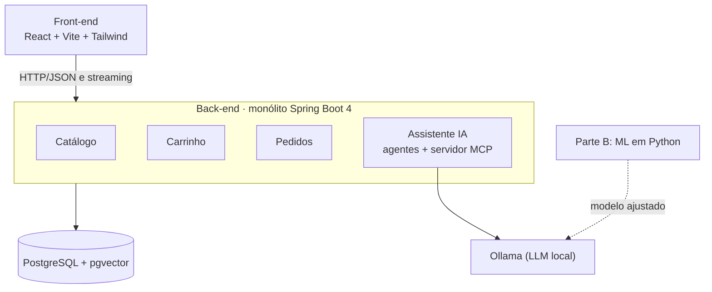

# AisleSmart 🛒🤖

> Loja online de alimentos com um assistente de compras por IA (Inteligência Artificial).
> Projeto de estudo e portfólio, focado em engenharia de software com IA e em Machine Learning.

**Status:** 🟡 em planejamento. A documentação está pronta; o código começa nas próximas etapas.

O nome vem de *aisle* (corredor do supermercado) + *smart* (inteligente): um "corredor inteligente" que ajuda o cliente a encontrar o que precisa conversando em português.

## O que o projeto faz

O cliente pode navegar pela loja normalmente ou conversar com o assistente:

- *"Quero um café em grãos de torra média, até R$40."* → o assistente mostra produtos reais do catálogo.
- *"Vocês aceitam troca?"* → a resposta vem dos documentos de política da loja, com a fonte citada.
- *"Coloca o segundo no carrinho."* → o assistente verifica o estoque e pede confirmação antes de alterar o carrinho.

## Duas partes

| Parte | O que é | Tecnologias |
| --- | --- | --- |
| **A: loja e assistente** | E-commerce com assistente que usa LLM (Large Language Model, modelo de linguagem grande), RAG (Retrieval-Augmented Generation, busca nos dados antes de responder), MCP (Model Context Protocol, protocolo de ferramentas) e agentes | React, Tailwind, Java 21, Spring Boot 4, Spring AI 2.0, PostgreSQL + pgvector, Ollama |
| **B: Machine Learning** | Conjunto de dados em português, modelo clássico de referência, fine-tuning (ajuste fino) de um LLM pequeno com QLoRA, avaliação comparativa e publicação no Hugging Face | Python, scikit-learn, Hugging Face Transformers e Datasets, Unsloth |

O modelo treinado na Parte B passa a funcionar dentro do assistente da Parte A, rodando localmente no Ollama.

## Arquitetura



Tudo roda localmente e sem custo: o LLM roda no Ollama, com a placa de vídeo do próprio computador.

## Estrutura do repositório

```
aislesmart/
  docs/        documentação do projeto (PRD, arquitetura e próximos documentos)
  backend/     Parte A: Java + Spring Boot (em breve)
  frontend/    Parte A: React + Tailwind (em breve)
  ml/          Parte B: Python, Machine Learning (em breve)
```

## Documentação

| Documento | Conteúdo | Status |
| --- | --- | --- |
| [01-PRD](docs/01-PRD.md) | O que o produto faz e por quê: objetivos, escopo, histórias de usuário, métricas | ✅ Rascunho v0.2 |
| [02-Arquitetura](docs/02-Arquitetura.md) | Como o sistema é montado: componentes, módulos, fluxos e decisões | ✅ Rascunho v0.2 |
| 03-Modelo de dados | Tabelas e relacionamentos | ⏳ Próximo |
| 04-Contratos de API | Endpoints da loja e do chat | ⏳ |
| 05-Ferramentas MCP | Ferramentas que o assistente pode usar | ⏳ |
| 06-Agentes | Papel e instruções de cada agente | ⏳ |
| 07-Machine Learning | Dados, treino, avaliação e publicação (Parte B) | ⏳ |

## Roteiro

- [x] Documentação inicial (PRD e arquitetura)
- [ ] Documentos 03 a 07
- [ ] Loja básica (catálogo, carrinho e pedido simulado)
- [ ] Assistente com LLM local e respostas em streaming
- [ ] RAG com pgvector
- [ ] Ferramentas e servidor MCP
- [ ] Agentes especializados
- [ ] Parte B: dados, modelo de referência, fine-tuning, avaliação e publicação no Hugging Face
- [ ] Artigo técnico com os resultados
- [ ] Vídeo de demonstração

## Como o projeto é desenvolvido

O código é escrito com apoio de IA, seguindo um processo organizado: **documentação primeiro**, depois instruções para a IA de código, depois o código em etapas pequenas, sempre revisadas e explicadas.

## Autoria

Projeto de estudo desenvolvido por Oliveira, estudante de Engenharia de Software.
