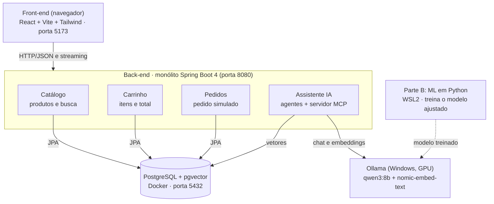

# 02-Arquitetura — AisleSmart

Nov 12, 2026

## Como ler este documento

Este documento descreve **como** o AisleSmart é organizado por dentro: quais partes existem, como elas conversam e onde cada uma roda. O 01-PRD diz **o que** construir; este diz como montar.

- **Status:** rascunho v0.2, em revisão por Oliveira.
- **Base:** decisões tomadas na seção 8 do 01-PRD.
- **Siglas:** toda sigla aparece com o significado entre parênteses; o glossário completo está na seção 11 do 01-PRD.
- **Próximo documento:** 03-Modelo de dados.

> **Para iniciante:** arquitetura é a "planta da casa" do software. A IA de código vai seguir esta planta. Se uma parte não estiver descrita aqui, ela vai construir do jeito dela.

## 1. Decisões de base e versões

A arquitetura parte de cinco decisões já tomadas no PRD (Product Requirements Document, documento de requisitos do produto) e de uma regra de versões: o Spring AI 2.0 só funciona com Spring Boot 4.

| Decisão | Escolha | Motivo |
| --- | --- | --- |
| Arquitetura | Monólito modular | Um único back-end é mais simples de rodar, testar e depurar no primeiro projeto |
| LLM | Ollama, local | Sem custo; a RTX 4060 (8 GB de VRAM, a memória da placa de vídeo) roda modelos de 7 a 8B (bilhões de parâmetros) |
| Usuário | Fixo de teste | Foco na IA, sem tela de login |
| Demo | Vídeo + GitHub | Sem custo de servidor |
| Machine Learning (Parte B) | Python, na pasta ml/ do mesmo repositório | Python é o padrão da área de ML (Machine Learning, aprendizado de máquina) |

**Versões**

| Peça | Versão | Observação |
| --- | --- | --- |
| Java | 21 | O Spring AI 2.0 pede Java 21 para desenvolvimento |
| Spring Boot | 4.x | O Spring AI 2.0 foi feito para Spring Boot 4.0/4.1 e não roda no 3.x |
| Spring AI | 2.0.x | Lançado em junho de 2026; conferir a correção mais recente ao criar o projeto |
| Node.js | LTS | Para o front-end |
| React + Vite + Tailwind | Atuais | JavaScript, sem TypeScript |
| PostgreSQL + pgvector | Imagem Docker `pgvector/pgvector` | Banco da loja e banco vetorial no mesmo lugar |
| Ollama | Atual | Modelos `qwen3:8b` e `nomic-embed-text` |
| Python | 3.x | Conferir a versão exigida pelo Unsloth antes de instalar |
| scikit-learn, Transformers, Datasets, Unsloth | Atuais | Bibliotecas de ML da Parte B |

Fontes das versões: [anúncio do Spring AI 2.0 GA](https://spring.io/blog/2026/06/12/spring-ai-2-0-0-GA-available-now/) e [Spring AI 2.0.0-M1](https://spring.io/blog/2025/12/11/spring-ai-2-0-0-M1-available-now/).

## 2. Componentes

Tudo roda no seu computador: o navegador com o front-end, um único back-end com quatro módulos, o banco PostgreSQL e o Ollama. Os notebooks Python da Parte B ficam à parte e só entregam o modelo treinado, que passa a rodar no Ollama (seção 8).



O módulo Assistente IA é o único que conversa com o Ollama. Os demais módulos são a loja comum e funcionam mesmo com o Ollama desligado.

## 3. Módulos do back-end

O back-end é um **monólito modular**: um único projeto Spring Boot, dividido em pacotes que funcionam como módulos independentes. Um monólito bem dividido é mais fácil de separar em serviços depois, porque as fronteiras já estão limpas ([guia de Spring Modulith](https://stevenpg.com/posts/ultimate-guide-spring-modulith/)).

| Módulo | Responsabilidade | Histórias do PRD |
| --- | --- | --- |
| `catalogo` | Produtos, categorias, busca e estoque | HU-01, HU-02 |
| `carrinho` | Itens, quantidades e total | HU-03 |
| `pedidos` | Pedido simulado, status e baixa de estoque | HU-04, HU-09 |
| `assistente` | Chat, RAG, agentes e ferramentas da IA | HU-05 a HU-09 |
| `compartilhado` | Configuração, tratamento de erros, usuário fixo | Todas |

**Regras entre módulos**

1. Um módulo só usa outro pela classe `Service` pública dele. Nunca acessa o `Repository` (banco) de outro módulo.
2. O módulo `assistente` não acessa o banco da loja diretamente. Ele usa ferramentas, e as ferramentas chamam os `Service` de catálogo, carrinho e pedidos.
3. Os módulos da loja não sabem que a IA existe: nenhum deles depende do `assistente`.

**Estrutura de pastas (proposta)**

```
backend/
  pom.xml
  src/main/java/br/com/aislesmart/
    AisleSmartApplication.java
    catalogo/
      ProdutoController.java
      CatalogoService.java      <- porta de entrada pública
      Produto.java
      ProdutoRepository.java
    carrinho/                   (mesmo padrão)
    pedidos/                    (mesmo padrão)
    assistente/
      ChatController.java
      AssistenteService.java
      filtros/                  extração de filtros com o modelo ajustado (Parte B)
      rag/                      ingestão e busca nos documentos
      agentes/                  roteador, produtos, políticas, pedidos
      ferramentas/              estoque, carrinho, pedido (@Tool)
    compartilhado/
  src/main/resources/
    application.yml
    politicas/                  trocas.md, entrega.md, validade.md, pagamento.md
    db/                         scripts de criação e dados de exemplo
```

> **Para iniciante:** *Controller* recebe as requisições do front-end; *Service* tem as regras de negócio; *Repository* fala com o banco. Essa divisão em camadas é o padrão mais comum em Spring Boot.

## 4. Front-end

O front-end é uma aplicação React criada com Vite, estilizada com Tailwind e escrita em JavaScript. Ele não tem regra de negócio: só mostra dados e chama a API do back-end.

```
frontend/
  package.json
  vite.config.js              proxy: /api -> localhost:8080
  src/
    main.jsx
    App.jsx                   rotas das páginas
    paginas/                  Catalogo.jsx, Produto.jsx, Carrinho.jsx, Pedido.jsx
    componentes/              Cabecalho.jsx, CardProduto.jsx
    chat/                     WidgetChat.jsx, MensagemChat.jsx, BotaoConfirmar.jsx
    servicos/                 api.js (todas as chamadas ao back-end)
```

- **Rotas entre páginas:** React Router (proposto).
- **Chamadas à API:** concentradas em `servicos/api.js`, para que nenhum componente fale com o back-end por conta própria.
- **Proxy do Vite:** em desenvolvimento, o front-end (porta 5173) repassa tudo que começa com `/api` para o back-end (porta 8080). Isso evita erros de CORS (Cross-Origin Resource Sharing, compartilhamento entre origens diferentes).

> **Para iniciante:** CORS é uma proteção do navegador que bloqueia chamadas entre endereços diferentes. O proxy faz o navegador "achar" que tudo vem do mesmo lugar.

## 5. Fluxo de uma pergunta

Toda pergunta do chat segue o mesmo caminho, e nenhuma alteração no carrinho acontece sem um clique do cliente.

**Caminho de uma pergunta**

1. O `WidgetChat` envia a mensagem e o identificador da conversa para `POST /api/chat`.
2. O `ChatController` repassa para o `AssistenteService`, que recupera o histórico da conversa (memória).
3. O **agente roteador** pede ao LLM (Large Language Model, modelo de linguagem grande) para classificar a intenção: produtos, políticas ou pedidos. Na fase da Parte B, o modelo ajustado também extrai os filtros da pergunta (categoria, preço máximo, restrições).
4. O agente escolhido trabalha:
   - **produtos:** busca trechos no banco vetorial (RAG, Retrieval-Augmented Generation: busca nos dados antes de responder), aplica os filtros e confere preço e estoque por ferramenta;
   - **políticas:** busca trechos dos documentos de política (RAG) e cita a fonte;
   - **pedidos:** usa ferramentas para consultar pedido ou propor uma alteração no carrinho.
5. A resposta volta ao front-end aos poucos (streaming) e aparece no chat.

**Confirmação de ações (regra de segurança)**

O LLM nunca altera o carrinho sozinho. A ferramenta de carrinho apenas **propõe** a ação; quem executa é o cliente.

1. O agente de pedidos chama a ferramenta `proporItemCarrinho`, que verifica o estoque e devolve uma proposta (produto, peso ou volume, quantidade, preço).
2. O front-end mostra a proposta com o botão **Confirmar**.
3. Ao clicar, o front-end chama diretamente `POST /api/carrinho/itens`, a mesma rota usada pela loja normal.

Assim, mesmo que o LLM erre ou seja enganado por uma mensagem maliciosa, nada muda sem o clique do cliente (critério da HU-08 no PRD).

## 6. Dados e RAG

Um único PostgreSQL guarda as tabelas da loja e os vetores do RAG, graças à extensão pgvector.

- **Tabelas da loja** (produto, categoria, carrinho, pedido): acessadas com Spring Data JPA (Java Persistence API, a forma padrão do Java de falar com o banco). Detalhes no 03-Modelo de dados.
- **Tabela de vetores:** criada e gerenciada pelo `PgVectorStore` do Spring AI.

**Ingestão (preparar o RAG)**

1. Ao iniciar o back-end, um componente do `assistente/rag` lê os produtos do banco e os arquivos de `politicas/`.
2. Cada texto é dividido em trechos (*chunks*).
3. Cada trecho vira um vetor com o modelo `nomic-embed-text` (768 dimensões; o tamanho configurado na tabela precisa ser o mesmo).
4. Os vetores são gravados com metadados: tipo (`produto` ou `politica`), id do produto ou nome do documento.

**Consulta**

O agente de produtos filtra por `tipo = produto` e o de políticas por `tipo = politica`. Assim, uma pergunta sobre trocas nunca recebe a descrição de um pacote de café como contexto.

> **Para iniciante:** a ingestão é feita uma vez (ou quando os dados mudam); a consulta acontece a cada pergunta.

## 7. Ambiente local

O PostgreSQL roda em Docker; o Ollama roda direto no Windows, para usar a placa de vídeo sem configuração extra.

| Serviço | Onde roda | Porta | Como iniciar |
| --- | --- | --- | --- |
| Front-end | Vite | 5173 | `npm run dev` |
| Back-end | Spring Boot | 8080 | `mvnw spring-boot:run` |
| PostgreSQL + pgvector | Docker Desktop | 5432 | `docker compose up -d` |
| Ollama | Windows (nativo) | 11434 | Inicia junto com o Windows |
| Notebooks de ML (Parte B) | Python no WSL2 (Windows Subsystem for Linux, um Linux dentro do Windows) | 8888 | jupyter lab |

**Repositório (monorepo)**

```
aislesmart/
  README.md
  CLAUDE.md                instruções para a IA de código
  docs/                    01-PRD, 02-Arquitetura, ...
  docker-compose.yml       PostgreSQL + pgvector
  backend/                 Parte A: Java + Spring Boot
  frontend/                Parte A: React + Tailwind
  ml/                      Parte B: Python (Machine Learning)
```

- **Configuração:** em `application.yml`; senhas e endereços vêm de variáveis de ambiente, nunca escritos no código.
- **Build do back-end:** Maven, com o *wrapper* (`mvnw`) incluso no projeto (ADR 09).

> **Para iniciante:** monorepo é um único repositório no GitHub com front-end, back-end e documentação juntos. Fica mais fácil para você e para a IA de código enxergarem o projeto inteiro.

## 8. Parte B: Machine Learning

A Parte B fica na pasta `ml/` e é escrita em Python. Ela não roda junto com a loja: serve para criar o conjunto de dados, treinar e avaliar os modelos e publicá-los no Hugging Face. O resultado final, o modelo ajustado, volta para a Parte A rodando no Ollama.

```
ml/
  requirements.txt          bibliotecas Python do projeto
  dados/                    perguntas de clientes (treino e teste)
  notebooks/
    01_dados.ipynb          criação e revisão do conjunto de dados
    02_baseline.ipynb       modelo clássico com scikit-learn
    03_finetuning.ipynb     fine-tuning com Unsloth (QLoRA)
    04_avaliacao.ipynb      comparação dos modelos (pesquisa)
  relatorio/                resultados da pesquisa e rascunho do artigo
```

**Etapas**

1. **Dados:** perguntas de clientes em português, cada uma com a resposta esperada (intenção e filtros em JSON, JavaScript Object Notation, um formato de dados em texto). Parte escrita à mão e parte gerada com ajuda de um LLM, sempre revisada.
2. **Baseline (modelo de referência):** classificador de intenção com scikit-learn. Serve de base de comparação.
3. **Fine-tuning (ajuste fino):** modelo base de cerca de 4B parâmetros, ajustado com QLoRA (Quantized Low-Rank Adaptation) no Unsloth, na RTX 4060.
4. **Avaliação (pesquisa):** comparar baseline × modelo ajustado × `qwen3:8b` sem ajuste, em taxa de acerto e tempo de resposta.
5. **Publicação:** conjunto de dados e modelo (no formato GGUF, usado pelo Ollama) no Hugging Face, com model card (página de documentação).
6. **Integração:** o Ollama roda o modelo direto do Hugging Face com `ollama run hf.co/<usuario>/<modelo>` ([documentação do Hugging Face](https://huggingface.co/docs/hub/ollama)), e o módulo `assistente/filtros` passa a usá-lo.

O modelo base exato e o formato dos filtros serão definidos no documento 07-Machine Learning.

## 9. Evolução por fases

A arquitetura cresce junto com o projeto: cada fase acrescenta uma peça e só começa quando a anterior está funcionando.

| Fase | O que entra na arquitetura | Teste de "pronto" |
| --- | --- | --- |
| 4. Loja básica | Módulos `catalogo`, `carrinho`, `pedidos` e o front-end | HU-01 a HU-04 passando |
| 5. LLM | Módulo `assistente` com `ChatClient`, Ollama, streaming e memória | Conversa simples no widget |
| 6. RAG | pgvector, ingestão de produtos e políticas | HU-06 e HU-07 passando |
| 7. Ferramentas e MCP | Primeiro ferramentas locais (`@Tool`); depois as mesmas ferramentas expostas via MCP | HU-08 e HU-09 passando |
| 8. Agentes | Roteador e os três agentes especializados | 18 de 20 perguntas de teste certas |
| Parte B (pode correr em paralelo a partir da fase 5) | Pasta ml/, modelo ajustado publicado e rodando no Ollama, módulo assistente/filtros | HU-10 passando |

**Sobre a fase 7:** no Spring AI 2.0, uma única aplicação Spring Boot pode ser ao mesmo tempo cliente e servidor MCP, e qualquer serviço vira ferramenta MCP com a anotação `@McpTool` ([artigo sobre o Spring AI 2.0](https://www.issoh.co.jp/tech/details/12778/), em japonês). Por isso, o servidor MCP ficará dentro do próprio back-end (ADR 12).

## 10. Decisões registradas e perguntas em aberto

Doze decisões já estão tomadas e só uma pergunta continua em aberto (o modelo base do fine-tuning, que será decidido no 07-Machine Learning).

> **Para iniciante:** ADR (*Architecture Decision Record*) é o registro curto de uma decisão e do motivo. Daqui a três meses, ele responde "por que fizemos assim?".

| ADR | Decisão | Motivo |
| --- | --- | --- |
| 01 | Monólito modular | Mais simples para o primeiro projeto; fácil de separar depois |
| 02 | Ollama nativo no Windows | Usa a GPU (Graphics Processing Unit, placa de vídeo) sem configuração extra no Docker |
| 03 | pgvector no mesmo PostgreSQL | Um banco só para a loja e para o RAG |
| 04 | Confirmação de carrinho por botão | O LLM nunca altera dados sozinho |
| 05 | JavaScript, sem TypeScript | Preferência de stack definida no início |
| 06 | Monorepo | Código e documentos juntos, visíveis para a IA de código |
| 07 | Python para a Parte B, na pasta ml/ | Padrão da área de ML; não mistura com o código Java da loja |
| 08 | Modelo ajustado servido pelo Ollama | Roda do mesmo jeito que os outros modelos, sem custo |
| 09 | Maven como ferramenta de build | Mais comum nos exemplos de Spring |
| 10 | Pacote Java br.com.aislesmart | Segue o nome do projeto |
| 11 | Spring Modulith só depois do MVP | Uma ferramenta a menos para aprender agora |
| 12 | Servidor MCP dentro do próprio back-end | Mais simples para o primeiro projeto; o Spring AI 2.0 permite isso com a anotação @McpTool |

**Perguntas (marcadas = respondidas; a resposta está na tabela acima)**

- [x] Ferramenta de build do back-end: Maven ou Gradle? Sugestão: Maven, mais comum em exemplos de Spring.
- [x] Nome do pacote Java: sugestão `br.com.aislesmart`.
- [x] Usar o Spring Modulith para verificar as regras entre módulos com um teste automático? Sugestão: depois do MVP.
- [x] Servidor MCP na fase 7: dentro do próprio monólito (mais simples) ou como projeto separado (mais didático)?
- [x] Docker Desktop: instalado e funcionando (Docker 29.9.2), acessível pelo terminal do WSL2.
- [ ] Modelo base para o fine-tuning (cerca de 4B parâmetros): a escolher no 07-Machine Learning.

## Fontes

- [Spring AI 2.0.0 GA (blog oficial do Spring)](https://spring.io/blog/2026/06/12/spring-ai-2-0-0-GA-available-now/)
- [Spring AI 2.0.0-M1: Spring Boot 4 e Java 21 (blog oficial do Spring)](https://spring.io/blog/2025/12/11/spring-ai-2-0-0-M1-available-now/)
- [Spring AI 2.0: Spring Boot 4 e MCP (artigo técnico, em japonês)](https://www.issoh.co.jp/tech/details/12778/)
- [Spring Modulith (repositório oficial)](https://github.com/spring-projects/spring-modulith/blob/main/readme.adoc)
- [Guia de Spring Modulith (Steven Pg)](https://stevenpg.com/posts/ultimate-guide-spring-modulith/)
- [Spring AI: MCP Server Boot Starter (documentação oficial)](https://docs.spring.io/spring-ai/reference/2.1/api/mcp/mcp-server-boot-starter-docs.html)
- [Hugging Face: usar o Ollama com modelos GGUF (documentação oficial)](https://huggingface.co/docs/hub/ollama)
- [Guia do Unsloth Studio: modelos por VRAM (InsiderLLM)](https://insiderllm.com/guides/unsloth-studio-setup-guide/)
