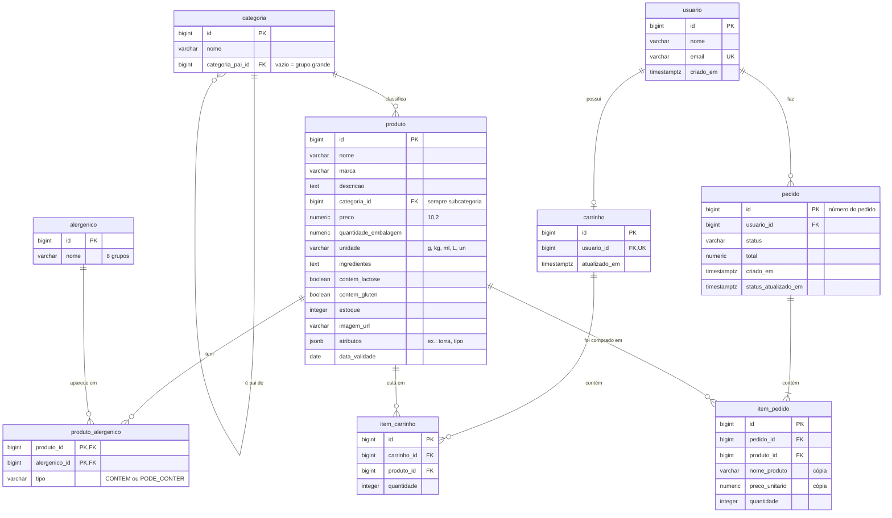
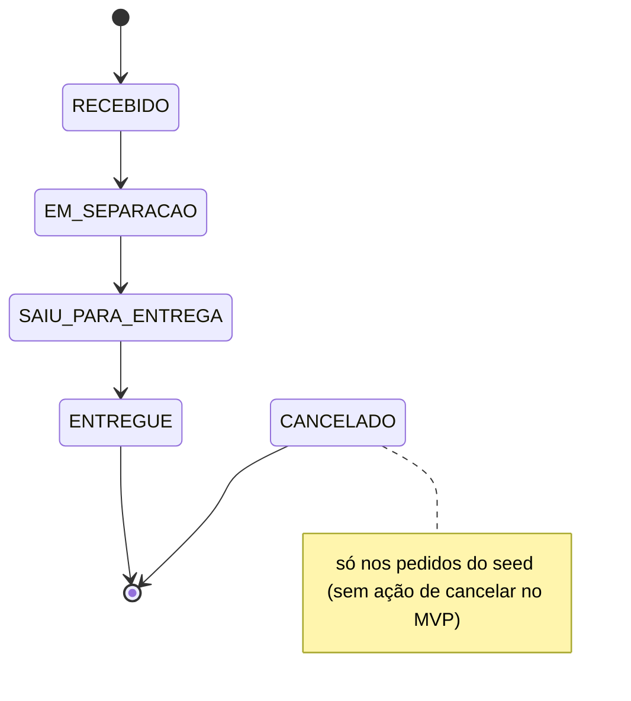

# 03-Modelo de dados — AisleSmart

Nov 13, 2026 · @Oliveira

## Como ler este documento

Este documento define **quais dados o AisleSmart guarda e como eles se ligam**: tabelas, campos, regras e a parte do banco usada pela IA (vetores do RAG e memória do chat). O 01-PRD diz o que construir, o 02-Arquitetura diz como montar, e este documento diz o que fica guardado no banco.

- **Status:** rascunho v0.1, em revisão por Oliveira.
- **Base:** histórias de usuário do 01-PRD (HU-01 a HU-10) e regras entre módulos do 02-Arquitetura (seção 3).
- **Siglas:** toda sigla aparece com o significado entre parênteses; o glossário completo está na seção 11 do 01-PRD.
- **Próximo documento:** 04-Contratos de API.

> **Para iniciante:** o modelo de dados é a "planta do armário" do sistema: quais gavetas existem (tabelas), o que cabe em cada uma (campos) e quais gavetas dependem de outras (relacionamentos). A IA de código vai criar as tabelas exatamente como estão aqui.

## 1. Visão geral

O banco é um único PostgreSQL com a extensão pgvector (ADR 03). Ele tem dois grupos de tabelas:

- **Tabelas da loja (nossas):** definidas neste documento, criadas por scripts em `backend/src/main/resources/db/`.
- **Tabelas da IA (do framework):** criadas e gerenciadas pelo Spring AI. Aqui só registramos que existem e como configurá-las.

| Módulo | Tabela | Para que serve |
| --- | --- | --- |
| `catalogo` | `categoria` | Grupos e subcategorias de alimentos (dois níveis) |
| `catalogo` | `produto` | Os 30 a 50 produtos fictícios |
| `catalogo` | `alergenico` | Lista fixa com 8 grupos de alergênicos |
| `catalogo` | `produto_alergenico` | Quais produtos contêm (ou podem conter) cada alergênico |
| `compartilhado` | `usuario` | O usuário fixo de teste do MVP (Produto Mínimo Viável) |
| `carrinho` | `carrinho` | Um carrinho por usuário |
| `carrinho` | `item_carrinho` | Produtos e quantidades do carrinho |
| `pedidos` | `pedido` | Pedido simulado e seu status |
| `pedidos` | `item_pedido` | Itens do pedido, com nome e preço copiados no momento da compra |
| `assistente` | `vector_store` | Vetores do RAG (Retrieval-Augmented Generation, geração aumentada por recuperação). Criada pelo Spring AI |
| `assistente` | `SPRING_AI_CHAT_MEMORY` | Histórico das conversas do chat. Criada pelo Spring AI |

## 2. Decisões registradas

Quinze decisões foram tomadas na construção deste documento.

| Nº | Decisão | Motivo |
| --- | --- | --- |
| D01 | Categorias em dois níveis, na mesma tabela (`categoria_pai_id`) | Página mostra os grupos grandes; filtros e a Parte B usam a subcategoria (ex.: "café") |
| D02 | Café fica em Mercearia → Café | Costume do varejo: "Bebidas" é o que já vem pronto para beber. Corrige o exemplo `categoria: café` do PRD |
| D03 | Alergênicos agrupados em 8 grupos | Mais simples para o seed e para a Parte B do que os 18 itens oficiais da RDC 26/2015 |
| D04 | "Pode conter" incluído (`CONTEM` / `PODE_CONTER`) | Uma coluna a mais deixa o assistente mais seguro ao falar de traços |
| D05 | Lactose e glúten como campos próprios do produto | São regras separadas dos alergênicos (RDC 136/2017 e Lei 10.674/2003) e viram filtros diretos |
| D06 | Detalhes específicos em `atributos` (JSONB) | Torra, tipo, sabor etc. variam por produto; evita colunas vazias |
| D07 | `data_validade` gerada pelo seed a partir da data atual | As datas nunca ficam vencidas no vídeo de demonstração |
| D08 | Carrinho não guarda preço; um produto por linha | O total usa sempre o preço atual; repetir o produto soma a quantidade |
| D09 | `item_pedido` copia nome e preço (snapshot) | Mudança de preço não altera pedidos antigos |
| D10 | 5 status, com `CANCELADO` só como status | A ação de cancelar fica fora do MVP |
| D11 | Status só muda por `PedidosService.avancarStatus()`; pedidos prontos no seed | Teste da HU-09 sem código extra; avanço automático fácil no futuro |
| D12 | Usuário com `id`, `nome`, `email` (único), `criado_em` | Mínimo necessário (PRD e LGPD); senha só com o login, como `senha_hash` |
| D13 | Entre módulos: chave estrangeira no banco, só o id no Java | Cumpre a regra 1 da seção 3 do 02-Arquitetura |
| D14 | Políticas divididas em pedaços por seção (`##`) | Cada resposta cita documento e seção (HU-07) |
| D15 | Vetor do produto só com dados estáveis; sem preço e estoque | Preço e estoque vêm sempre do banco pelas ferramentas (regra da seção 7 do PRD) |

## 3. Diagrama de relacionamentos

As tabelas do Spring AI (`vector_store` e `SPRING_AI_CHAT_MEMORY`) não aparecem no diagrama porque não têm chave estrangeira para as tabelas da loja. Elas estão na seção 6.

> **Para iniciante:** `||--o{` quer dizer "um para zero ou muitos"; `||--o|`, "um para zero ou um"; `||--|{`, "um para um ou muitos". PK (*Primary Key*) é a chave primária, FK (*Foreign Key*) aponta para outra tabela e UK (*Unique Key*) é um valor que não se repete.

## 4. Tabelas da loja

Convenções que valem para todas as tabelas:

- Nomes de tabelas e colunas em português, no singular e em `snake_case` (palavras separadas por `_`).
- Chave primária `id` do tipo `BIGINT`, gerada pelo banco (`GENERATED ALWAYS AS IDENTITY`).
- Valores em dinheiro em `NUMERIC(10,2)`, nunca em `float`, que arredonda centavos ([documentação do PostgreSQL](https://www.postgresql.org/docs/current/datatype-numeric.html)).
- Datas com hora em `TIMESTAMPTZ` (data e hora com fuso horário).
- Campos marcados como "obrigatório" são `NOT NULL`.

### 4.1 Módulo `catalogo`

**`categoria`**

| Campo | Tipo | Regras |
| --- | --- | --- |
| `id` | `BIGINT` | Chave primária |
| `nome` | `VARCHAR(60)` | Obrigatório; único dentro do mesmo pai |
| `categoria_pai_id` | `BIGINT` | Chave estrangeira para `categoria.id`; vazio (`NULL`) nos grupos grandes |

Regra: só existem dois níveis. Uma subcategoria nunca tem filhas.

Categorias sugeridas para o seed (ajustáveis):

| Grupo | Subcategorias |
| --- | --- |
| Mercearia | Café, Arroz e feijão, Massas, Açúcar e adoçantes |
| Bebidas | Sucos, Refrigerantes, Águas, Chás prontos |
| Hortifrúti | Frutas, Legumes e verduras |
| Laticínios | Leites, Iogurtes, Queijos |
| Lanches | Biscoitos, Barras de cereal, Salgadinhos |

**`produto`**

| Campo | Tipo | Regras |
| --- | --- | --- |
| `id` | `BIGINT` | Chave primária |
| `nome` | `VARCHAR(120)` | Obrigatório |
| `marca` | `VARCHAR(60)` | Obrigatório |
| `descricao` | `TEXT` | Obrigatório |
| `categoria_id` | `BIGINT` | Obrigatório; chave estrangeira para `categoria.id`; **sempre uma subcategoria** |
| `preco` | `NUMERIC(10,2)` | Obrigatório; maior que zero |
| `quantidade_embalagem` | `NUMERIC(10,2)` | Obrigatório; maior que zero (ex.: `500`) |
| `unidade` | `VARCHAR(3)` | Obrigatório; um destes: `g`, `kg`, `ml`, `L`, `un` |
| `ingredientes` | `TEXT` | Obrigatório (hortifrúti pode repetir o nome do produto) |
| `contem_lactose` | `BOOLEAN` | Obrigatório |
| `contem_gluten` | `BOOLEAN` | Obrigatório |
| `estoque` | `INTEGER` | Obrigatório; zero ou mais. Zero = "Indisponível" (HU-02) |
| `imagem_url` | `VARCHAR(255)` | Opcional |
| `atributos` | `JSONB` | Opcional; detalhes específicos, ex.: `{"torra": "média", "tipo": "grãos"}` ([documentação do PostgreSQL](https://www.postgresql.org/docs/current/datatype-json.html)) |
| `data_validade` | `DATE` | Obrigatório; gerada pelo seed (seção 7) |

Regras:

- Chaves dentro de `atributos` em minúsculas e sem acento (`torra`, `tipo`, `sabor`), para a busca e a Parte B usarem sempre os mesmos nomes.
- Simplificação: uma data de validade por produto. Lojas reais controlam validade por lote.

**`alergenico`**

| Campo | Tipo | Regras |
| --- | --- | --- |
| `id` | `BIGINT` | Chave primária |
| `nome` | `VARCHAR(40)` | Obrigatório; único |

Lista fixa (criada pelo seed): Cereais com glúten, Crustáceos, Ovos, Peixes, Amendoim, Soja, Leite, Castanhas e nozes. Os grupos seguem a lista da RDC 26/2015 da ANVISA (Agência Nacional de Vigilância Sanitária), sem o látex natural, que não se aplica a uma loja de alimentos. O grupo "Castanhas e nozes" reúne amêndoa, avelã, castanha-de-caju, castanha-do-pará, macadâmia, nozes, pecã, pistache, pinoli e castanha.

**`produto_alergenico`**

| Campo | Tipo | Regras |
| --- | --- | --- |
| `produto_id` | `BIGINT` | Chave estrangeira para `produto.id` |
| `alergenico_id` | `BIGINT` | Chave estrangeira para `alergenico.id` |
| `tipo` | `VARCHAR(12)` | Obrigatório; `CONTEM` ou `PODE_CONTER` |

Chave primária composta: (`produto_id`, `alergenico_id`). Um produto não pode ter o mesmo alergênico duas vezes.

> **Para iniciante:** lactose não é alergênico. Alergia à proteína do leite é tratada pela RDC 26/2015, e intolerância à lactose pelas RDC 135/2017 e 136/2017. Por isso um produto pode ter `contem_lactose = false` e, ao mesmo tempo, o alergênico "Leite" (ex.: leite sem lactose).

### 4.2 Módulo `compartilhado`

**`usuario`**

| Campo | Tipo | Regras |
| --- | --- | --- |
| `id` | `BIGINT` | Chave primária |
| `nome` | `VARCHAR(100)` | Obrigatório |
| `email` | `VARCHAR(150)` | Obrigatório; único |
| `criado_em` | `TIMESTAMPTZ` | Obrigatório; padrão: data e hora atuais |

Fora de propósito: CPF, telefone e endereço. O PRD proíbe pedir dados sensíveis, a entrega é simulada e a LGPD (Lei Geral de Proteção de Dados) manda coletar só o necessário (princípio da necessidade, art. 6º, III). A senha só entra junto com o login, como `senha_hash`, nunca em texto.

### 4.3 Módulo `carrinho`

**`carrinho`**

| Campo | Tipo | Regras |
| --- | --- | --- |
| `id` | `BIGINT` | Chave primária |
| `usuario_id` | `BIGINT` | Obrigatório; chave estrangeira para `usuario.id`; único (um carrinho por usuário) |
| `atualizado_em` | `TIMESTAMPTZ` | Obrigatório; muda a cada alteração |

**`item_carrinho`**

| Campo | Tipo | Regras |
| --- | --- | --- |
| `id` | `BIGINT` | Chave primária |
| `carrinho_id` | `BIGINT` | Obrigatório; chave estrangeira para `carrinho.id` |
| `produto_id` | `BIGINT` | Obrigatório; chave estrangeira para `produto.id` |
| `quantidade` | `INTEGER` | Obrigatório; maior que zero |

Regras:

- O par (`carrinho_id`, `produto_id`) é único. Adicionar um produto que já está no carrinho soma a quantidade.
- O carrinho não guarda preço. O total é calculado com o preço atual do produto (HU-03).
- A quantidade não pode passar do estoque (HU-03). A verificação é feita no `CatalogoService`, não no banco.

### 4.4 Módulo `pedidos`

**`pedido`**

| Campo | Tipo | Regras |
| --- | --- | --- |
| `id` | `BIGINT` | Chave primária; é o **número do pedido** (HU-04) |
| `usuario_id` | `BIGINT` | Obrigatório; chave estrangeira para `usuario.id` |
| `status` | `VARCHAR(20)` | Obrigatório; um dos 5 status abaixo; começa em `RECEBIDO` |
| `total` | `NUMERIC(10,2)` | Obrigatório; soma dos itens no momento da compra |
| `criado_em` | `TIMESTAMPTZ` | Obrigatório |
| `status_atualizado_em` | `TIMESTAMPTZ` | Obrigatório; data e hora da última mudança de status |

**`item_pedido`**

| Campo | Tipo | Regras |
| --- | --- | --- |
| `id` | `BIGINT` | Chave primária |
| `pedido_id` | `BIGINT` | Obrigatório; chave estrangeira para `pedido.id` |
| `produto_id` | `BIGINT` | Obrigatório; chave estrangeira para `produto.id` |
| `nome_produto` | `VARCHAR(120)` | Obrigatório; **cópia** do nome no momento da compra |
| `preco_unitario` | `NUMERIC(10,2)` | Obrigatório; **cópia** do preço no momento da compra |
| `quantidade` | `INTEGER` | Obrigatório; maior que zero |

**Status do pedido**

Regras:

- O status só muda pelo método `PedidosService.avancarStatus()`. Nenhum outro lugar do código altera o campo `status` diretamente. Cada mudança atualiza `status_atualizado_em`.
- `CANCELADO` existe só como status (aparece em pedidos do seed). A ação de cancelar fica fora do MVP.
- Ao fechar o pedido, o estoque de cada produto é reduzido (HU-04), pelo `CatalogoService`.
- Futuro: uma tarefa com `@Scheduled` do Spring pode avançar os status pelo tempo, chamando o mesmo `avancarStatus()` ([documentação do Spring](https://docs.spring.io/spring-framework/reference/integration/scheduling.html)).

### 4.5 Ligação entre módulos

No banco, `item_carrinho.produto_id` e `item_pedido.produto_id` são chaves estrangeiras normais, para garantir que nenhum item aponte para um produto que não existe.

No Java, os módulos `carrinho` e `pedidos` guardam só o número `produtoId` (um `Long`), sem relação JPA (Java Persistence API) com a classe `Produto`. Quando precisam de nome, preço ou estoque, chamam o `CatalogoService`. Isso cumpre a regra 1 da seção 3 do 02-Arquitetura: um módulo nunca acessa o `Repository` de outro.

## 5. Índices

Com 30 a 50 produtos, o banco seria rápido mesmo sem índices. Mesmo assim, criamos os índices que acompanham as buscas mais comuns, como boa prática:

| Tabela | Índice | Para quê |
| --- | --- | --- |
| `produto` | `categoria_id` | Filtro por categoria (HU-01) |
| `item_carrinho` | (`carrinho_id`, `produto_id`), único | Regra de um produto por linha |
| `pedido` | `usuario_id` | "Meus pedidos" e HU-09 |
| `item_pedido` | `pedido_id` | Itens de um pedido |

O PostgreSQL já cria índices automaticamente para chaves primárias e campos únicos.

## 6. Tabelas da IA (Spring AI)

### 6.1 Vetores do RAG: `vector_store`

A tabela é criada pelo `PgVectorStore` do Spring AI quando a criação automática está ligada. Ela tem quatro colunas: `id`, `content` (o texto do pedaço), `metadata` (JSON) e `embedding` (o vetor), com um índice HNSW por distância de cosseno ([documentação do Spring AI](https://docs.spring.io/spring-ai/reference/2.1/api/vectordbs/pgvector.html)).

Configuração em `application.yml`:

| Propriedade | Valor | Motivo |
| --- | --- | --- |
| `spring.ai.vectorstore.pgvector.initialize-schema` | `true` | No Spring AI atual, a criação automática da tabela vem desligada por padrão ([documentação](https://docs.spring.io/spring-ai/reference/2.0/api/vectordbs/pgvector.html)) |
| `spring.ai.vectorstore.pgvector.dimensions` | `768` | Tamanho do vetor do `nomic-embed-text` (02-Arquitetura, seção 6). Se mudar, a tabela precisa ser recriada |

> **Para iniciante:** *embedding* é o texto transformado numa lista de 768 números que representa o significado dele. Textos parecidos geram números parecidos. *Chunk* (pedaço) é a parte do texto que vira um embedding.

**O que vira pedaço**

| Origem | Como divide | Texto do pedaço | Metadados |
| --- | --- | --- | --- |
| Produto | **Um pedaço por produto** | Nome, marca, categoria e subcategoria, descrição, ingredientes, alergênicos ("contém" e "pode conter"), lactose, glúten e atributos | `tipo: produto`, `produto_id`, `categoria` |
| Política | **Um pedaço por seção** (cada título `##` de `trocas.md`, `entrega.md`, `validade.md`, `pagamento.md`) | O título da seção e o texto dela | `tipo: politica`, `documento` (ex.: `trocas.md`), `secao` (ex.: `Prazo para troca`) |

Regras:

- **Preço e estoque nunca entram no pedaço nem nos metadados** (D15). O RAG encontra os produtos parecidos e devolve os `produto_id`. Depois, o `CatalogoService` aplica os filtros de preço e estoque com os dados atuais do banco. Assim, o assistente nunca mostra um preço desatualizado (regra da seção 7 do PRD).
- Os agentes filtram pelos metadados: o de produtos usa `tipo = produto`, e o de políticas usa `tipo = politica` (02-Arquitetura, seção 6).
- A citação de fonte da HU-07 usa `documento` + `secao` ("trocas.md, seção Prazo para troca").
- **Ingestão:** ao iniciar, o back-end apaga os pedaços antigos e gera todos de novo. Com cerca de 50 produtos e 4 documentos, isso leva poucos segundos e evita vetores desatualizados.
- A forma de dividir por `##` (leitor de Markdown do Spring AI ou um divisor simples próprio) será confirmada na fase 6 (RAG), conferindo a documentação da versão instalada.

### 6.2 Memória do chat: `SPRING_AI_CHAT_MEMORY`

O histórico da conversa (HU-05: "o assistente lembra o que foi dito antes") é guardado pelo `JdbcChatMemoryRepository` do Spring AI, na tabela `SPRING_AI_CHAT_MEMORY`. A coluna `sequence_id`, que ordena as mensagens, foi adicionada na versão 2.0.0 ([documentação do Spring AI](https://docs.spring.io/spring-ai/reference/api/chat-memory.html)).

| Propriedade | Valor | Motivo |
| --- | --- | --- |
| `spring.ai.chat.memory.repository.jdbc.initialize-schema` | `always` | O padrão (`embedded`) só cria a tabela em bancos embutidos, como H2; o PostgreSQL não é um deles ([documentação](https://docs.spring.io/spring-ai/reference/api/chat-memory.html)) |

O identificador da conversa (`conversation_id`) é gerado pelo front-end e enviado em cada mensagem para `POST /api/chat` (02-Arquitetura, seção 5). Os detalhes ficam no 04-Contratos de API.

## 7. Dados de exemplo (seed)

O seed preenche o banco para desenvolvimento e para o vídeo de demonstração.

| O quê | Quantidade | Observação |
| --- | --- | --- |
| Categorias | 5 grupos + subcategorias | Tabela da seção 4.1 |
| Alergênicos | 8 | Lista fixa da seção 4.1 |
| Produtos | 30 a 50 | Variados; incluir sem lactose, sem glúten, com "pode conter" e cafés com atributos diferentes (torra, tipo) |
| Produtos sem estoque | 2 ou 3 | Para testar "Indisponível" (HU-02) |
| Produtos perto do vencimento | 1 ou 2 | `data_validade = CURRENT_DATE + INTERVAL '5 days'`, para testar a política de validade |
| Usuário | 1 | O usuário fixo de teste |
| Pedidos antigos | 3 ou 4 | Um em cada status, inclusive `CANCELADO`, para testar a HU-09 |

Regra da validade: o seed nunca usa data fixa. Ele calcula a partir do dia em que roda, por exemplo `CURRENT_DATE + INTERVAL '180 days'` ([documentação do PostgreSQL](https://www.postgresql.org/docs/current/functions-datetime.html)). Antes de gravar o vídeo, recriar o banco (`docker compose down -v` e `docker compose up -d`).

## 8. Perguntas em aberto

- [ ] Ferramenta para criar as tabelas: scripts SQL simples em `db/` (como diz o 02-Arquitetura) ou uma ferramenta de versões do banco, como Flyway? A decidir no início da fase 4.
- [ ] Forma de dividir as políticas por `##`: confirmar na fase 6 (seção 6.1).
- [ ] Lista final de produtos e preços do seed: definida junto com o script de seed.

## Fontes

- [PostgreSQL: tipos numéricos (documentação oficial)](https://www.postgresql.org/docs/current/datatype-numeric.html)
- [PostgreSQL: tipos JSON e JSONB (documentação oficial)](https://www.postgresql.org/docs/current/datatype-json.html)
- [PostgreSQL: funções de data e hora (documentação oficial)](https://www.postgresql.org/docs/current/functions-datetime.html)
- [Spring AI 2.0: PgVector (documentação oficial)](https://docs.spring.io/spring-ai/reference/2.0/api/vectordbs/pgvector.html)
- [Spring AI 2.1: PgVector, esquema da tabela (documentação oficial)](https://docs.spring.io/spring-ai/reference/2.1/api/vectordbs/pgvector.html)
- [Spring AI: Chat Memory (documentação oficial)](https://docs.spring.io/spring-ai/reference/api/chat-memory.html)
- [Spring Framework: agendamento de tarefas (documentação oficial)](https://docs.spring.io/spring-framework/reference/integration/scheduling.html)
- [ANVISA: RDC 26/2015 sobre rotulagem de alergênicos (Ministério da Justiça)](https://www.gov.br/mj/pt-br/assuntos/noticias/rotulos-de-alimentos-devem-informar-ingredientes-alergenicos/ConsumoeSaden43AlimentosAlergnicos.pdf)
- [ANVISA: RDC 136/2017 sobre lactose (versão em inglês)](https://www.gov.br/anvisa/en/rules-and-regulations/arquivos/rdc-136-2017-e.pdf)
- [Food Safety Brazil: alergia ao leite × intolerância à lactose](https://foodsafetybrazil.org/category/alergenicos-aprendihoje/page/5)
- [Lei 13.709/2018 — LGPD (Planalto)](https://www.planalto.gov.br/ccivil_03/_ato2015-2018/2018/lei/l13709.htm)
