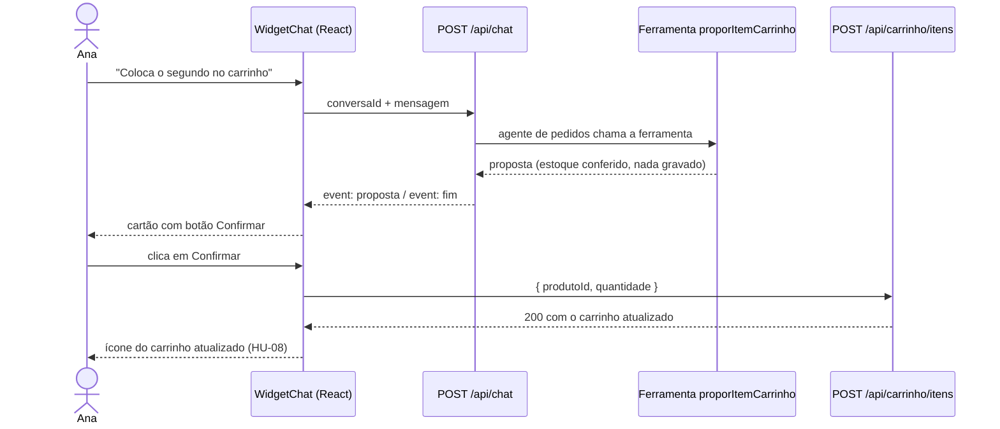

# 04-Contratos de API — AisleSmart

Nov 15, 2026 · Paulo Oliveira

## Como ler este documento

Este documento define **como o front-end e o back-end conversam**: cada endereço (endpoint), o que ele recebe, o que devolve e quais erros pode dar. O 01-PRD diz o que construir, o 02-Arquitetura diz como montar, o 03-Modelo de dados diz o que fica guardado, e este documento diz o que passa pela rede.

- **Status:** rascunho v0.4 (20/11/2026): linha da HU-10 na seção 9 ajustada; o modelo ajustado classifica a intenção (07-Machine Learning, M01). v0.3 (17/11/2026): lista final de intenções e de códigos de erro do chat definida no 06-Agentes (seção 7.2).
- **Base:** histórias de usuário do 01-PRD (HU-01 a HU-09), seções 4 e 5 do 02-Arquitetura e tabelas do 03-Modelo de dados.
- **Siglas:** toda sigla aparece com o significado entre parênteses; o glossário completo está na seção 11 do 01-PRD.
- **Próximo documento:** 05-Ferramentas MCP.

> **Para iniciante:** API (Application Programming Interface, interface de programação) é a "porta" que o back-end abre para o front-end. O contrato é o combinado dos dois lados: se o front mandar isto, o back devolve aquilo. A IA de código vai criar os Controllers e o `servicos/api.js` exatamente como estão aqui.

## 1. Visão geral

São 11 endpoints, todos com o prefixo `/api`. Em desenvolvimento, o front-end (porta 5173) chama `/api/...` e o proxy do Vite repassa para o back-end (porta 8080), por isso não é preciso configurar CORS (Cross-Origin Resource Sharing, compartilhamento entre origens diferentes) (02-Arquitetura, seção 4).

| Método | Caminho | Para que serve | HU | Módulo |
| --- | --- | --- | --- | --- |
| `GET` | `/api/categorias` | Lista os grupos e as subcategorias | HU-01 | `catalogo` |
| `GET` | `/api/produtos` | Lista produtos com busca, filtro e paginação | HU-01 | `catalogo` |
| `GET` | `/api/produtos/{id}` | Detalhe de um produto | HU-02 | `catalogo` |
| `GET` | `/api/carrinho` | Mostra o carrinho com o total | HU-03 | `carrinho` |
| `POST` | `/api/carrinho/itens` | Adiciona um produto (soma se já existir) | HU-03, HU-08 | `carrinho` |
| `PUT` | `/api/carrinho/itens/{produtoId}` | Define a quantidade de um item | HU-03 | `carrinho` |
| `DELETE` | `/api/carrinho/itens/{produtoId}` | Remove um item | HU-03 | `carrinho` |
| `POST` | `/api/pedidos` | Fecha o carrinho e cria o pedido simulado | HU-04 | `pedidos` |
| `GET` | `/api/pedidos` | Lista os pedidos do usuário | HU-09 | `pedidos` |
| `GET` | `/api/pedidos/{id}` | Detalhe e status de um pedido | HU-04, HU-09 | `pedidos` |
| `POST` | `/api/chat` | Envia uma mensagem ao assistente; a resposta chega aos poucos | HU-05 a HU-09 | `assistente` |

Além deles, o springdoc-openapi publica a documentação automática em `/swagger-ui.html` e `/v3/api-docs` (seção 8).

> **Para iniciante:** `GET` lê, `POST` cria ou dispara uma ação, `PUT` substitui um valor e `DELETE` remove. `{id}` é uma parte variável do caminho: `/api/produtos/12` pede o produto 12.

## 2. Decisões registradas

Dezesseis decisões foram tomadas na construção deste documento.

| Nº | Decisão | Motivo |
| --- | --- | --- |
| C01 | Caminhos em português, no plural, com prefixo `/api` e sem número de versão (`/v1`) | Combina com o código e os documentos; versão só faz sentido quando houver clientes externos |
| C02 | Campos do JSON (JavaScript Object Notation) em `camelCase` (ex.: `precoUnitario`) | Padrão do Java e do JavaScript; o banco continua em `snake_case` (03-Modelo de dados) |
| C03 | Nenhuma rota recebe o id do usuário; o back-end usa o usuário fixo do módulo `compartilhado` | Usuário fixo no MVP (Produto Mínimo Viável). Quando houver login, as rotas continuam iguais |
| C04 | A API devolve sempre DTOs (Data Transfer Objects, objetos só para transporte), nunca as entidades JPA (Java Persistence API) | Esconde campos internos e evita que uma mudança no banco quebre o front-end |
| C05 | Dinheiro como número JSON com duas casas (ex.: `36.90`); datas como texto no padrão ISO-8601 | O front formata em reais. ISO-8601 já é o padrão do Jackson 3, usado pelo Spring Boot 4 |
| C06 | Erros no formato Problem Details (RFC 9457), com o campo extra `codigo` | Formato padronizado pela IETF (Internet Engineering Task Force) e já suportado pelo Spring com a classe `ProblemDetail` |
| C07 | Paginação no formato padrão do Spring Data (`page` começa em 0, `size` padrão 12) e ordem fixa por nome | Formato oficial e estável, sem código próprio; ordem fixa evita aceitar campos de ordenação não conferidos |
| C08 | Na listagem, só `disponivel` (sim/não); o número exato do estoque só no detalhe | A HU-01 não pede estoque; a HU-02 pede |
| C09 | Itens do carrinho identificados pelo `produtoId`, não pelo id da linha | Há um produto por linha (D08), então o `produtoId` já identifica o item |
| C10 | Toda alteração no carrinho devolve o carrinho inteiro, com o total recalculado | Cumpre a HU-03 e o front-end não faz contas (02-Arquitetura, seção 4) |
| C11 | Falta de estoque e carrinho vazio respondem `409 Conflict`; dados mal preenchidos respondem `400 Bad Request` | 409 indica conflito com o estado atual do servidor (o estoque); 400 indica pedido mal formado |
| C12 | Pedido inexistente e pedido de outro usuário recebem a mesma resposta `404` | Não revela que o pedido existe (HU-09) |
| C13 | Não existe rota para mudar o status do pedido | Status só muda por `PedidosService.avancarStatus()` (D11); os pedidos de teste vêm do seed |
| C14 | O chat responde com SSE (Server-Sent Events, eventos enviados pelo servidor), com seis tipos de evento | Texto aos poucos (HU-05), cards (HU-06), fonte (HU-07) e proposta com botão Confirmar (HU-08) na mesma resposta |
| C15 | O `conversaId` é um UUID (Universally Unique Identifier, identificador único) criado pelo front-end; não há rota de histórico no MVP | A memória fica no back-end (03-Modelo de dados, seção 6.2); "Nova conversa" só gera outro UUID |
| C16 | springdoc-openapi 3.x gera a página Swagger UI a partir dos Controllers | Permite testar a API no navegador antes do front-end ficar pronto e mostra a documentação no portfólio |

## 3. Convenções gerais

### 3.1 Requisições e respostas

- Corpo em JSON, com `Content-Type: application/json` e codificação UTF-8. A exceção é a resposta do chat (seção 7).
- Ids são números inteiros (o `BIGINT` do banco vira `Long` no Java e número no JSON).
- Campos opcionais sem valor aparecem como `null` (ex.: `imagemUrl`).
- Datas com hora seguem o ISO-8601 com fuso, ex.: `"2026-11-15T14:32:10.123-03:00"`; datas sem hora, ex.: `"2027-05-14"`. O Jackson 3, que vem no Spring Boot 4, já grava datas assim por padrão ([blog oficial do Spring](https://spring.io/blog/2025/10/07/introducing-jackson-3-support-in-spring/)).
- Dinheiro sempre com duas casas. O front-end mostra em reais com `Intl.NumberFormat('pt-BR', { style: 'currency', currency: 'BRL' })`.

> **Para iniciante:** DTO é uma classe simples (no Java, um `record`) que só carrega os dados que vão para a rede. A entidade `Produto` do banco tem tudo; o `ProdutoResumoDTO` da listagem tem só o que o card precisa.

### 3.2 Códigos de status HTTP

| Código | Quando |
| --- | --- |
| `200 OK` | Leitura ou alteração com sucesso, com corpo |
| `201 Created` | Pedido criado; vem com o cabeçalho `Location` apontando para o novo pedido |
| `400 Bad Request` | Campo faltando, tipo errado ou valor fora do limite |
| `404 Not Found` | Produto, categoria, item ou pedido que não existe (ou que não é do usuário) |
| `409 Conflict` | Regra de negócio barrou a ação: sem estoque, estoque insuficiente, carrinho vazio |
| `500 Internal Server Error` | Erro inesperado; a mensagem nunca mostra detalhes internos |

### 3.3 Formato de erro

Todo erro usa Problem Details (RFC 9457), com o tipo de conteúdo `application/problem+json`. O Spring já tem a classe `ProblemDetail` para isso ([documentação do Spring](https://docs.spring.io/spring-framework/reference/web/webmvc/mvc-ann-rest-exceptions.html)). Os campos padrão são `type`, `title`, `status`, `detail` e `instance`. O AisleSmart acrescenta `codigo` (para o front-end decidir o que fazer) e, quando útil, dados extras.

Exemplo de estoque insuficiente:

```json
{
  "type": "about:blank",
  "title": "Conflict",
  "status": 409,
  "detail": "Só há 3 unidades de Café Torrado em Grãos Torra Média 500 g em estoque.",
  "instance": "/api/carrinho/itens",
  "codigo": "ESTOQUE_INSUFICIENTE",
  "produtoId": 12,
  "estoqueDisponivel": 3
}
```

Exemplo de validação:

```json
{
  "type": "about:blank",
  "title": "Bad Request",
  "status": 400,
  "detail": "Há campos inválidos na requisição.",
  "instance": "/api/carrinho/itens",
  "codigo": "VALIDACAO",
  "erros": [
    { "campo": "quantidade", "mensagem": "deve ser no mínimo 1" }
  ]
}
```

**Lista de códigos**

| `codigo` | Status | Quando |
| --- | --- | --- |
| `VALIDACAO` | 400 | Campo faltando ou inválido (lista em `erros`) |
| `CATEGORIA_NAO_ENCONTRADA` | 404 | `categoriaId` que não existe |
| `PRODUTO_NAO_ENCONTRADO` | 404 | Produto que não existe |
| `ITEM_NAO_ENCONTRADO` | 404 | `PUT` num produto que não está no carrinho |
| `PEDIDO_NAO_ENCONTRADO` | 404 | Pedido que não existe ou é de outro usuário (C12) |
| `PRODUTO_INDISPONIVEL` | 409 | Produto com estoque zero (HU-02) |
| `ESTOQUE_INSUFICIENTE` | 409 | Quantidade maior que o estoque (HU-03); traz `produtoId` e `estoqueDisponivel` |
| `CARRINHO_VAZIO` | 409 | Fechar pedido sem itens |
| `ERRO_INTERNO` | 500 | Qualquer erro inesperado |

**Como implementar (resumo para a IA de código)**

- Ligar `spring.mvc.problemdetails.enabled=true` no `application.yml`, para que os erros do próprio Spring (rota inexistente, JSON mal formado) também saiam nesse formato ([documentação do Spring](https://docs.spring.io/spring-framework/reference/web/webmvc/mvc-ann-rest-exceptions.html)).
- Criar no módulo `compartilhado` um `@RestControllerAdvice` que estende `ResponseEntityExceptionHandler` e converte as exceções de negócio (ex.: `EstoqueInsuficienteException`) em `ProblemDetail`, com `setProperty("codigo", ...)`.
- Sobrescrever o tratamento de `MethodArgumentNotValidException` para preencher a lista `erros` com campo e mensagem, porque a resposta padrão não diz qual campo falhou.
- As mensagens de `detail` são em português e pensadas para aparecer ao cliente.

## 4. Catálogo

### 4.1 `GET /api/categorias`

Devolve os grupos com as subcategorias, em ordem alfabética. É usado no menu de filtros (HU-01).

Resposta `200`:

```json
[
  {
    "id": 1,
    "nome": "Mercearia",
    "subcategorias": [
      { "id": 6, "nome": "Açúcar e adoçantes" },
      { "id": 7, "nome": "Café" }
    ]
  }
]
```

### 4.2 `GET /api/produtos`

Lista paginada de produtos (HU-01).

**Parâmetros (todos opcionais)**

| Parâmetro | Tipo | Regra |
| --- | --- | --- |
| `busca` | texto | Procura no nome e na marca, sem diferenciar maiúsculas de minúsculas. Máximo 60 caracteres |
| `categoriaId` | número | Aceita grupo ou subcategoria. Se for grupo, inclui todas as subcategorias dele |
| `page` | número | Página desejada, começando em `0`. Padrão: `0` |
| `size` | número | Produtos por página. Padrão: `12` (HU-01); máximo: `48` |

Exemplo: `GET /api/produtos?busca=café&categoriaId=1&page=0`

A ordem é sempre por nome, de A a Z. O parâmetro `sort` do Spring é ignorado: a documentação do Spring Data avisa que ele não confere os nomes de campo recebidos, e a responsabilidade fica com a aplicação ([documentação do Spring Data](https://docs.spring.io/spring-data/commons/reference/3.5/repositories/core-extensions-web.html)).

Resposta `200` (formato `PagedModel` do Spring Data):

```json
{
  "content": [
    {
      "id": 12,
      "nome": "Café Torrado em Grãos Torra Média",
      "marca": "Serra Alta",
      "preco": 36.90,
      "quantidadeEmbalagem": 500,
      "unidade": "g",
      "imagemUrl": "/imagens/produtos/12.jpg",
      "categoria": { "id": 7, "nome": "Café", "grupo": "Mercearia" },
      "disponivel": true
    }
  ],
  "page": { "size": 12, "number": 0, "totalElements": 4, "totalPages": 1 }
}
```

- `content` e `page` vêm em inglês porque são o formato oficial do Spring Data, gerado pela classe `PagedModel`. O Controller devolve `new PagedModel<>(pagina)`, que a documentação recomenda no lugar de devolver o `Page` direto ([documentação do Spring Data](https://docs.spring.io/spring-data/commons/reference/repositories/core-extensions-web.html)).
- `page.number` começa em 0; a tela mostra `number + 1`.
- Configuração: `spring.data.web.pageable.default-page-size=12` e `spring.data.web.pageable.max-page-size=48`.
- Nenhum produto encontrado não é erro: volta `content: []`.

Erros: `400 VALIDACAO` (ex.: `busca` com mais de 60 caracteres) e `404 CATEGORIA_NAO_ENCONTRADA`.

### 4.3 `GET /api/produtos/{id}`

Detalhe completo do produto (HU-02).

Resposta `200`:

```json
{
  "id": 12,
  "nome": "Café Torrado em Grãos Torra Média",
  "marca": "Serra Alta",
  "descricao": "Café 100% arábica, notas de chocolate e caramelo.",
  "preco": 36.90,
  "quantidadeEmbalagem": 500,
  "unidade": "g",
  "imagemUrl": "/imagens/produtos/12.jpg",
  "categoria": { "id": 7, "nome": "Café", "grupo": "Mercearia" },
  "ingredientes": "Café torrado em grãos.",
  "contemLactose": false,
  "contemGluten": false,
  "alergenicos": {
    "contem": [],
    "podeConter": []
  },
  "atributos": { "torra": "média", "tipo": "grãos" },
  "estoque": 18,
  "disponivel": true,
  "dataValidade": "2027-05-14"
}
```

- `disponivel` é `false` quando `estoque` é 0; a tela mostra "Indisponível" e desativa o botão de adicionar (HU-02).
- `alergenicos` separa "contém" de "pode conter" (D04), com os nomes dos 8 grupos. Ex.: um biscoito pode vir com `"contem": ["Cereais com glúten", "Leite"]` e `"podeConter": ["Castanhas e nozes"]`. Lactose e glúten vêm em campos próprios (D05).
- `atributos` é o JSONB do banco, repassado como objeto; pode vir `{}`.

Erros: `400 VALIDACAO` (id que não é número) e `404 PRODUTO_NAO_ENCONTRADO`.

## 5. Carrinho

O carrinho é sempre o do usuário fixo. Ele é criado automaticamente na primeira consulta ou alteração, então `GET /api/carrinho` nunca dá 404.

**Formato do carrinho** (o mesmo em todas as respostas desta seção):

```json
{
  "itens": [
    {
      "produtoId": 12,
      "nome": "Café Torrado em Grãos Torra Média",
      "marca": "Serra Alta",
      "imagemUrl": "/imagens/produtos/12.jpg",
      "quantidadeEmbalagem": 500,
      "unidade": "g",
      "precoUnitario": 36.90,
      "quantidade": 2,
      "subtotal": 73.80,
      "estoqueDisponivel": 18,
      "disponivel": true
    }
  ],
  "quantidadeTotalItens": 2,
  "total": 73.80,
  "atualizadoEm": "2026-11-15T14:32:10.123-03:00"
}
```

- `precoUnitario` é sempre o preço **atual** do produto, porque o carrinho não guarda preço (D08). O `subtotal` e o `total` são calculados no back-end a cada resposta (HU-03).
- `quantidadeTotalItens` é a soma das quantidades; o `Cabecalho` mostra esse número no ícone do carrinho.
- `disponivel: false` aparece se o produto ficou sem estoque depois de entrar no carrinho. O item continua lá, mas o pedido não fecha até o cliente remover ou ajustar.
- Carrinho vazio: `itens: []`, `quantidadeTotalItens: 0`, `total: 0.00`.

### 5.1 `GET /api/carrinho`

Resposta `200` com o carrinho.

### 5.2 `POST /api/carrinho/itens`

Adiciona um produto. Se ele já está no carrinho, **soma** a quantidade (D08). É a mesma rota que o botão Confirmar do chat chama (02-Arquitetura, seção 5).

Corpo:

```json
{ "produtoId": 12, "quantidade": 1 }
```

| Campo | Regra |
| --- | --- |
| `produtoId` | Obrigatório |
| `quantidade` | Obrigatório; de 1 a 99 |

Resposta `200` com o carrinho atualizado. A resposta é `200`, e não `201`, porque a ação pode só aumentar uma linha que já existia.

Erros:

- `400 VALIDACAO`;
- `404 PRODUTO_NAO_ENCONTRADO`;
- `409 PRODUTO_INDISPONIVEL` (estoque zero);
- `409 ESTOQUE_INSUFICIENTE`, quando a quantidade que já está no carrinho mais a nova passa do estoque (HU-03). Nada é alterado.

### 5.3 `PUT /api/carrinho/itens/{produtoId}`

Define a quantidade exata de um item que já está no carrinho (ex.: o seletor "− 2 +" da tela).

Corpo:

```json
{ "quantidade": 3 }
```

`quantidade` vai de 1 a 99 e não pode passar do estoque. Para tirar o item, usa-se o `DELETE`.

Resposta `200` com o carrinho. Erros: `400 VALIDACAO`, `404 ITEM_NAO_ENCONTRADO`, `409 ESTOQUE_INSUFICIENTE`.

### 5.4 `DELETE /api/carrinho/itens/{produtoId}`

Remove o item. Resposta `200` com o carrinho atualizado, para a tela já receber o novo total.

Se o produto existe mas não está no carrinho, a resposta também é `200` (o resultado final é o mesmo: o item não está lá). Erro: `404 PRODUTO_NAO_ENCONTRADO` só se o produto não existir.

> **Para iniciante:** muitas APIs devolvem `204 No Content` (sem corpo) no `DELETE`. Aqui devolvemos o carrinho para o front-end não precisar fazer uma segunda chamada só para saber o novo total.

## 6. Pedidos

### 6.1 `POST /api/pedidos`

Fecha o carrinho atual e cria o pedido simulado (HU-04). Não tem corpo: o pedido é sempre feito a partir do carrinho do usuário.

O que acontece, numa única transação (tudo ou nada):

1. Confere se o carrinho tem itens.
2. Confere o estoque de **todos** os itens no `CatalogoService`.
3. Cria o pedido com status `RECEBIDO`, copiando nome e preço de cada item (D09).
4. Reduz o estoque de cada produto (HU-04).
5. Esvazia o carrinho.

Resposta `201`, com o cabeçalho `Location: /api/pedidos/{id}` e o pedido no corpo (formato da seção 6.3).

Erros:

- `409 CARRINHO_VAZIO`;
- `409 ESTOQUE_INSUFICIENTE`, com a lista dos itens com problema. Nada é gravado e o carrinho fica como estava:

```json
{
  "type": "about:blank",
  "title": "Conflict",
  "status": 409,
  "detail": "Alguns itens não têm estoque suficiente.",
  "instance": "/api/pedidos",
  "codigo": "ESTOQUE_INSUFICIENTE",
  "itens": [ { "produtoId": 12, "estoqueDisponivel": 1 } ]
}
```

> **Para iniciante:** transação é um bloco de operações no banco que acontece por inteiro ou não acontece. Se o passo 4 falhar, os passos 3 e 5 são desfeitos. No Spring, isso se faz com `@Transactional` no método do Service.

### 6.2 `GET /api/pedidos`

Lista os pedidos do usuário, do mais novo para o mais antigo. Não tem paginação, porque o usuário de teste tem poucos pedidos.

Resposta `200`:

```json
[
  {
    "id": 1004,
    "status": "EM_SEPARACAO",
    "total": 73.80,
    "quantidadeItens": 2,
    "criadoEm": "2026-11-14T10:05:00-03:00"
  }
]
```

### 6.3 `GET /api/pedidos/{id}`

Detalhe de um pedido (HU-04 e HU-09).

Resposta `200`:

```json
{
  "id": 1004,
  "status": "EM_SEPARACAO",
  "total": 73.80,
  "criadoEm": "2026-11-14T10:05:00-03:00",
  "statusAtualizadoEm": "2026-11-14T11:20:00-03:00",
  "itens": [
    {
      "produtoId": 12,
      "nomeProduto": "Café Torrado em Grãos Torra Média",
      "precoUnitario": 36.90,
      "quantidade": 2,
      "subtotal": 73.80
    }
  ]
}
```

- `nomeProduto` e `precoUnitario` são os valores copiados no momento da compra (D09), mesmo que o produto tenha mudado depois.
- Erro: `404 PEDIDO_NAO_ENCONTRADO`, tanto para pedido inexistente quanto para pedido de outro usuário (C12).

**Status do pedido**

A API envia o código; o front-end mostra o texto.

| `status` | Texto na tela |
| --- | --- |
| `RECEBIDO` | Recebido |
| `EM_SEPARACAO` | Em separação |
| `SAIU_PARA_ENTREGA` | Saiu para entrega |
| `ENTREGUE` | Entregue |
| `CANCELADO` | Cancelado |

## 7. Chat com o assistente

### 7.1 `POST /api/chat`

Envia uma mensagem e recebe a resposta aos poucos (HU-05).

Requisição:

```
POST /api/chat
Content-Type: application/json
Accept: text/event-stream
```

```json
{
  "conversaId": "6f1c2a9e-3b4d-4c8e-9a51-2d7e8f0b1c34",
  "mensagem": "Quero um café em grãos de torra média, até R$40."
}
```

| Campo | Regra |
| --- | --- |
| `conversaId` | Obrigatório; UUID gerado pelo front-end com `crypto.randomUUID()` e guardado no `sessionStorage`. É o `conversation_id` da memória do chat (03-Modelo de dados, seção 6.2) |
| `mensagem` | Obrigatório; de 1 a 1000 caracteres, sem contar espaços nas pontas |

Resposta: `200` com `Content-Type: text/event-stream`, que é o tipo definido pela especificação de SSE ([WHATWG HTML, seção 9.2](https://html.spec.whatwg.org/dev/server-sent-events.html)). A conexão fica aberta enquanto o assistente escreve e fecha depois do último evento.

Se o corpo for inválido, a resposta é um `400 VALIDACAO` normal, em JSON, e o streaming nem começa. Depois que o streaming começa, o status já foi enviado como `200`; por isso, qualquer falha a partir daí chega como um evento `erro` (seção 7.2).

> **Para iniciante:** SSE é uma resposta HTTP que não termina de uma vez. O servidor vai escrevendo blocos de texto, cada um com um nome (`event:`) e os dados (`data:`), separados por uma linha em branco. É mais simples que WebSocket porque só o servidor fala depois da pergunta, e isso é tudo de que um chat precisa.

### 7.2 Tipos de evento

Cada evento tem um nome (`event:`) e um JSON em `data:`.

| Evento | Quando chega | Dados | HU |
| --- | --- | --- | --- |
| `texto` | Várias vezes, conforme o LLM (Large Language Model, modelo de linguagem grande) escreve | `{ "conteudo": "Encontrei 3 opções" }` | HU-05 |
| `produtos` | Quando o agente de produtos encontra sugestões | `{ "produtos": [ ...até 5 itens no formato da listagem (seção 4.2)... ] }` | HU-06 |
| `proposta` | Quando o agente de pedidos propõe adicionar algo ao carrinho | Ver abaixo | HU-08 |
| `fonte` | Uma vez por trecho de política usado na resposta | `{ "documento": "trocas.md", "secao": "Prazo para troca" }` | HU-07 |
| `fim` | Sempre por último, se deu tudo certo | `{ "intencao": "PRODUTOS" }` | — |
| `erro` | Por último, se algo falhou no meio | `{ "codigo": "ASSISTENTE_INDISPONIVEL", "mensagem": "O assistente está fora do ar. Tente de novo em instantes." }` | — |

Dados da `proposta`:

```json
{
  "produtoId": 12,
  "nome": "Café Torrado em Grãos Torra Média",
  "quantidadeEmbalagem": 500,
  "unidade": "g",
  "quantidade": 1,
  "precoUnitario": 36.90,
  "subtotal": 36.90,
  "estoqueDisponivel": 18
}
```

Regras:

- **`fim` ou `erro` é sempre o último evento**, e só um dos dois aparece. A ordem dos outros não é garantida; o front-end monta a mensagem pelo tipo: junta os `texto`, mostra os cards dos `produtos`, o cartão com botão Confirmar da `proposta` e as fontes embaixo.
- O texto vai dentro de um JSON (`{"conteudo": ...}`), e não solto, porque quebras de linha no texto do LLM quebrariam as linhas `data:` do SSE.
- Os dados de `produtos` e `proposta` vêm das ferramentas, que leem preço e estoque do banco na hora (regra da seção 7 do PRD e D15). O LLM nunca escreve esses números por conta própria.
- Os dados de `produtos`, `proposta` e `fonte` têm exatamente o formato devolvido pelas ferramentas `buscarProdutos`, `proporItemCarrinho` e `buscarPoliticas` (05-Ferramentas MCP, seção 9). O `texto` dos trechos de política vai só para o LLM; o evento `fonte` leva só `documento` e `secao`.
- O evento `produtos` traz **todos** os produtos que a busca devolveu (até 5), mesmo que o texto comente só alguns (05, F14).
- Há no máximo **um** evento `produtos` por resposta. Se o agente buscar mais de uma vez, vai só o resultado da última busca (05, F15).
- `intencao` no `fim` registra qual agente respondeu. Serve para os logs e para conferir as 20 perguntas de teste. Lista final (06-Agentes, A01):

| `intencao` | Quem responde |
| --- | --- |
| `PRODUTOS` | Agente de produtos |
| `POLITICAS` | Agente de políticas |
| `PEDIDOS` | Agente de pedidos |
| `FORA_DO_TEMA` | Resposta pronta e neutra, sem LLM (saudações e assuntos fora da loja). Chega como um único evento `texto`, seguido do `fim` |

- Códigos de `erro` do chat (06-Agentes, A02). Os erros das ferramentas (ex.: `ESTOQUE_INSUFICIENTE`, `NADA_ENCONTRADO`) **não** viram evento `erro`: vão para o LLM, que explica ao cliente, e a resposta termina com `fim`.

| `codigo` | Quando | `mensagem` |
| --- | --- | --- |
| `ASSISTENTE_INDISPONIVEL` | O Ollama está desligado ou recusa a conexão | "O assistente está fora do ar. Tente de novo em instantes." |
| `TEMPO_ESGOTADO` | O Ollama não termina a resposta dentro do tempo limite (seção 7.4) | "O assistente demorou demais para responder. Tente de novo ou faça uma pergunta mais curta." |
| `ERRO_INTERNO` | Qualquer outra falha inesperada no back-end | "Algo deu errado. Tente de novo em instantes." |

- Se o `erro` chegar no meio da resposta, a tela mantém o texto que já chegou e mostra a mensagem de erro embaixo.
- O botão Enviar do chat fica desativado enquanto a resposta não termina (`fim` ou `erro`).

**Exemplo do que passa pela rede** (HU-06):

```
event:texto
data:{"conteudo":"Encontrei 2 cafés em grãos de torra média"}

event:texto
data:{"conteudo":" até R$40:"}

event:produtos
data:{"produtos":[{"id":12,"nome":"Café Torrado em Grãos Torra Média","marca":"Serra Alta","preco":36.90,"quantidadeEmbalagem":500,"unidade":"g","imagemUrl":"/imagens/produtos/12.jpg","categoria":{"id":7,"nome":"Café","grupo":"Mercearia"},"disponivel":true}]}

event:fim
data:{"intencao":"PRODUTOS"}

```

### 7.3 Como o front-end lê a resposta

O `EventSource`, que é a forma nativa do navegador de ler SSE, só faz requisições `GET` e não aceita corpo ([web-developpeur.com](https://www.web-developpeur.com/en/blog/sse-fetch-readable-stream-api-key)). Como o chat precisa de `POST` com JSON, o `servicos/api.js` usa `fetch` e lê o corpo aos poucos. Esboço:

```js
// servicos/api.js — esboço da leitura do chat
export async function enviarMensagem(conversaId, mensagem, aoReceberEvento) {
  const resposta = await fetch('/api/chat', {
    method: 'POST',
    headers: { 'Content-Type': 'application/json', Accept: 'text/event-stream' },
    body: JSON.stringify({ conversaId, mensagem }),
  });
  if (!resposta.ok) throw await resposta.json(); // 400 em Problem Details

  const leitor = resposta.body.pipeThrough(new TextDecoderStream()).getReader();
  let sobra = '';
  while (true) {
    const { value, done } = await leitor.read();
    if (done) break;
    sobra += value;
    const blocos = sobra.split('\n\n');
    sobra = blocos.pop(); // o último bloco pode estar incompleto
    for (const bloco of blocos) {
      const tipo = bloco.match(/^event:(.*)$/m)?.[1].trim() ?? 'message';
      const dados = bloco
        .split('\n')
        .filter((linha) => linha.startsWith('data:'))
        .map((linha) => linha.slice(5))
        .join('\n');
      if (dados) aoReceberEvento(tipo, JSON.parse(dados));
    }
  }
}
```

### 7.4 Como o back-end produz a resposta

- O `ChatController` devolve um `Flux<ServerSentEvent<...>>` com `produces = MediaType.TEXT_EVENT_STREAM_VALUE`. O Spring MVC aceita tipos reativos como o `Flux` e os transmite aos poucos quando o tipo pedido é `text/event-stream` ([documentação do Spring](https://docs.spring.io/spring-framework/reference/6.2-SNAPSHOT/web/webmvc/mvc-controller/ann-methods/return-types.html)). Não é preciso trocar para o Spring WebFlux.
- O texto vem do `ChatClient` do Spring AI com `.stream()`, que devolve um `Flux` de pedaços ([Baeldung](https://www.baeldung.com/spring-ai-chatclient-stream-response)). O `AssistenteService` converte cada pedaço num evento `texto` e junta os eventos das ferramentas (`produtos`, `proposta`, `fonte`) antes do `fim`.
- Um erro no `Flux` (ex.: Ollama desligado) vira o evento `erro`, em vez de derrubar a conexão sem aviso.
- O Ollama local pode demorar; o tempo limite de requisições assíncronas do Spring MVC deve ser ajustado (ex.: 120 segundos). Passado esse tempo, a resposta termina com `erro` `TEMPO_ESGOTADO`. O nome exato da propriedade no Spring Boot 4 será conferido na fase 5.

```java
@PostMapping(path = "/api/chat", produces = MediaType.TEXT_EVENT_STREAM_VALUE)
public Flux<ServerSentEvent<Object>> conversar(@Valid @RequestBody MensagemChatRequest pedido) {
    return assistenteService.responder(pedido.conversaId(), pedido.mensagem());
}
```

### 7.5 Confirmação de ações pelo chat

A proposta do chat não muda nada sozinha. Quem altera o carrinho é a mesma rota da loja, chamada pelo clique do cliente (ADR 04).



- A proposta não fica guardada no servidor. Ao confirmar, o `POST /api/carrinho/itens` confere o estoque de novo. Se ele acabou nesse meio-tempo, volta `409` e o widget mostra a mensagem de `detail`.
- O carrinho na tela é atualizado com a própria resposta do `POST` (seção 5.2), sem outra chamada.

## 8. Documentação automática (springdoc-openapi)

O springdoc-openapi lê os Controllers e as anotações de validação e gera a descrição no padrão OpenAPI 3, com uma página Swagger UI para testar cada endpoint no navegador. A linha 3.x é a compatível com o Spring Boot 4 ([repositório do springdoc](https://p.codekk.com/detail/62fcba55982bbb72602824ee)).

| Item | Valor |
| --- | --- |
| Dependência Maven | `org.springdoc:springdoc-openapi-starter-webmvc-ui` (versão 3.x; conferir a mais recente na fase 4) |
| Página de testes | `http://localhost:8080/swagger-ui.html` |
| Descrição em JSON | `http://localhost:8080/v3/api-docs` |

- **Este documento é a fonte da verdade.** O Swagger serve para conferir se o código ficou igual ao contrato.
- O Swagger UI não mostra bem respostas em streaming; o `POST /api/chat` é testado pelo widget ou pelo terminal com `curl -N`.

> **Para iniciante:** OpenAPI é um formato padrão para descrever APIs. Swagger UI é a página que transforma essa descrição em botões "Try it out", onde você testa cada endpoint sem escrever código.

## 9. Histórias de usuário × endpoints

Esta tabela confere que toda história tem um caminho na API.

| HU | Endpoints |
| --- | --- |
| HU-01 Ver catálogo | `GET /api/categorias`, `GET /api/produtos` |
| HU-02 Ver detalhe | `GET /api/produtos/{id}` |
| HU-03 Gerenciar carrinho | `GET /api/carrinho`, `POST /api/carrinho/itens`, `PUT` e `DELETE /api/carrinho/itens/{produtoId}` |
| HU-04 Fechar pedido | `POST /api/pedidos`, `GET /api/pedidos/{id}` |
| HU-05 Conversar | `POST /api/chat` (eventos `texto` e `fim`) |
| HU-06 Produtos pelo chat | `POST /api/chat` (evento `produtos`) |
| HU-07 Políticas | `POST /api/chat` (evento `fonte`) |
| HU-08 Carrinho pelo chat | `POST /api/chat` (evento `proposta`) + `POST /api/carrinho/itens` |
| HU-09 Pedido pelo chat | `POST /api/chat` (o agente usa as ferramentas de pedido); `GET /api/pedidos` na tela "Meus pedidos" |
| HU-10 Intenção (Parte B) | Nenhum endpoint novo: o modelo ajustado é usado pelo roteador dentro do `POST /api/chat` |

## 10. Fora do MVP

- Login e autenticação. Quando entrarem, as rotas continuam iguais (C03) e passa a existir um token no cabeçalho.
- Cancelar pedido e avançar status por rota (D10 e D11).
- Histórico do chat por rota (ex.: `GET /api/chat/{conversaId}`) e lista de conversas.
- Rotas de administração (cadastro de produtos e políticas); no MVP, tudo vem do seed.
- Versão na URL (`/api/v1`), limite de requisições por minuto e proteção contra pedido duplicado. No MVP, o botão "Fechar pedido" fica desativado enquanto espera a resposta.

## 11. Perguntas em aberto

Cada pergunta tem um momento certo para ser respondida. Ao chegar nele, a resposta é escrita no lugar indicado, o item é marcado com `[x]` e a versão do documento sobe (ex.: v0.1 → v0.2).

> **Lembrete para a IA:** ao trabalhar no 05-Ferramentas MCP, no 06-Agentes ou nas fases 4 e 5, verifique esta lista antes de terminar a etapa e avise Paulo Oliveira das perguntas daquela etapa.

| Pergunta | Quando responder | Onde a resposta entra |
| --- | --- | --- |
| [x] Os eventos `produtos`, `proposta` e `fonte` batem com o que as ferramentas devolvem ao `AssistenteService`? **Sim, conferido em 16/11/2026** (05, seção 9), com duas regras novas: todos os cards (F14) e só a última busca (F15) | No 05-Ferramentas MCP | Seção 7.2 |
| [x] Lista final de intenções (`intencao`) e de códigos de erro do chat. **Definida em 17/11/2026** (06-Agentes, A01 e A02): 4 intenções e 3 códigos de erro, com o novo `TEMPO_ESGOTADO` | No 06-Agentes | Seção 7.2 |
| [ ] A busca deve ignorar acentos ("cafe" encontrar "café")? Exige a extensão `unaccent` do PostgreSQL ou uma coluna normalizada | Início da fase 4, antes do primeiro script do banco, junto com "SQL ou Flyway" (03, seção 8) | Seção 4.2 |
| [ ] Nome exato da propriedade de tempo limite assíncrono no Spring Boot 4 | Fase 5, ao criar o `ChatController` (conferir na documentação oficial) | Seção 7.4 |

## Fontes

- [RFC 9457: Problem Details for HTTP APIs (IETF)](https://www.rfc-editor.org/rfc/rfc9457)
- [RFC 9110: HTTP Semantics, códigos de status (IETF)](https://www.rfc-editor.org/rfc/rfc9110.txt)
- [Spring Framework: Error Responses e ProblemDetail (documentação oficial)](https://docs.spring.io/spring-framework/reference/web/webmvc/mvc-ann-rest-exceptions.html)
- [Spring Framework: tipos de retorno no Spring MVC, inclusive Flux (documentação oficial)](https://docs.spring.io/spring-framework/reference/6.2-SNAPSHOT/web/webmvc/mvc-controller/ann-methods/return-types.html)
- [Spring Framework: requisições assíncronas e SSE no Spring MVC (documentação oficial)](https://docs.spring.io/spring/reference/web/webmvc/mvc-ann-async.html)
- [Spring Data: suporte web, Pageable e PagedModel (documentação oficial)](https://docs.spring.io/spring-data/commons/reference/repositories/core-extensions-web.html)
- [Spring Data 3.5: parâmetros page, size e sort (documentação oficial)](https://docs.spring.io/spring-data/commons/reference/3.5/repositories/core-extensions-web.html)
- [Introducing Jackson 3 support in Spring (blog oficial do Spring)](https://spring.io/blog/2025/10/07/introducing-jackson-3-support-in-spring/)
- [Spring AI: respostas em streaming com ChatClient (Baeldung)](https://www.baeldung.com/spring-ai-chatclient-stream-response)
- [WHATWG HTML: Server-sent events, formato do event stream (especificação)](https://html.spec.whatwg.org/dev/server-sent-events.html)
- [MDN: Using server-sent events](https://developer.mozilla.org/en-US/docs/Web/API/Server-sent_events/Using_server-sent_events)
- [SSE com fetch e ReadableStream, sem EventSource (web-developpeur.com)](https://www.web-developpeur.com/en/blog/sse-fetch-readable-stream-api-key)
- [springdoc-openapi: compatibilidade com Spring Boot 4 (README do projeto)](https://p.codekk.com/detail/62fcba55982bbb72602824ee)
