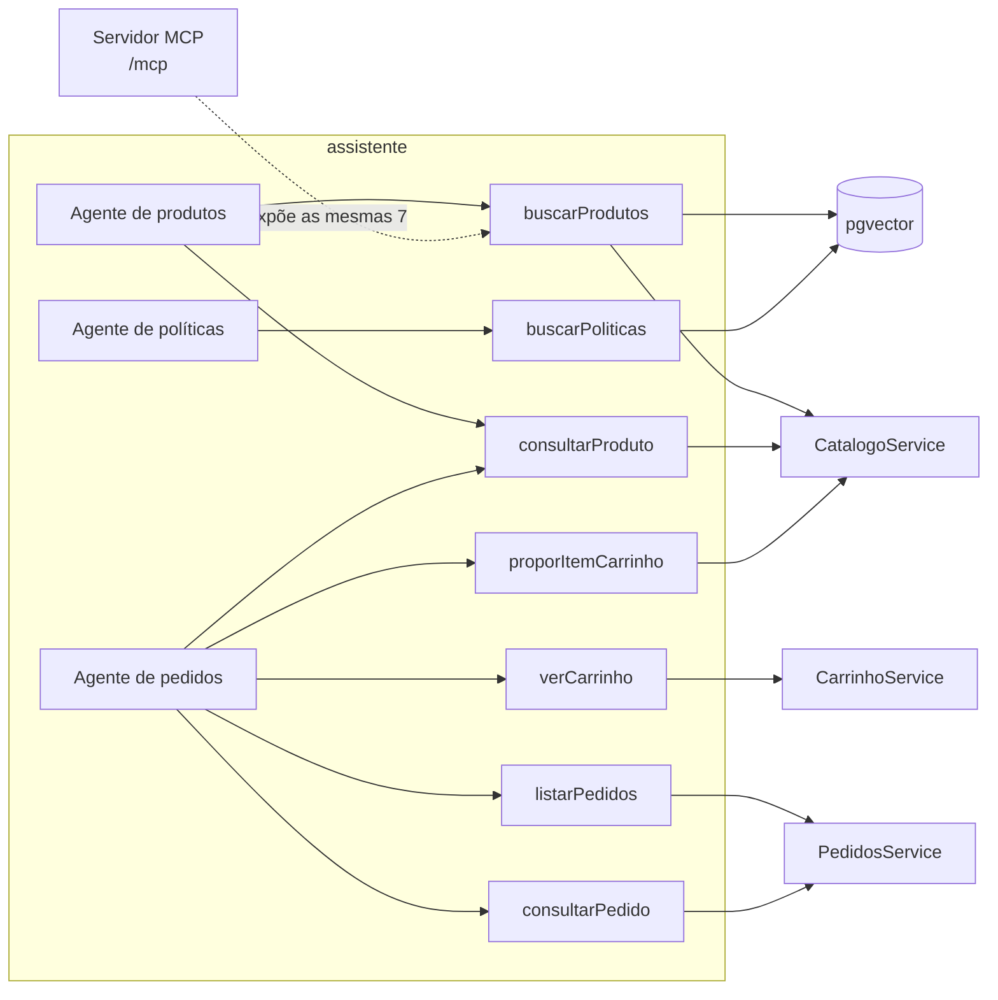

# 05-Ferramentas MCP — AisleSmart

Nov 16, 2026 · Paulo Oliveira

## Como ler este documento

Este documento define **as ferramentas que o assistente pode usar**: o nome de cada uma, o que ela recebe, o que devolve, quais erros pode dar e qual agente pode chamá-la. O 01-PRD diz o que construir, o 02-Arquitetura diz como montar, o 03-Modelo de dados diz o que fica guardado, o 04-Contratos de API diz o que passa pela rede, e este documento diz o que a IA consegue pedir para o sistema fazer.

- **Status:** rascunho v0.5 (20/11/2026): a HU-10 não usa mais ferramentas; o modelo ajustado classifica a intenção (07-Machine Learning, M01).
- **Base:** HU-05 a HU-09 do 01-PRD, seções 3, 5 e 8 do 02-Arquitetura (ADRs 04 e 12), D13 e D15 do 03-Modelo de dados e seção 7 do 04-Contratos de API.
- **Siglas:** toda sigla aparece com o significado entre parênteses; o glossário completo está na seção 11 do 01-PRD.
- **Próximo documento:** 06-Agentes.

> **Para iniciante:** uma ferramenta (*tool*) é um método Java que o LLM (Large Language Model, modelo de linguagem grande) pode **pedir** para executar. O LLM só vê o nome, a descrição e os parâmetros; quem executa é o nosso código, e o resultado volta para o LLM escrever a resposta. O MCP (Model Context Protocol, protocolo de contexto de modelo) é o padrão que deixa essas mesmas ferramentas disponíveis para qualquer outra aplicação de IA, como uma "tomada universal".

### Histórico

| Versão | Data | O que mudou |
| --- | --- | --- |
| v0.1 | 16/11/2026 | Primeira versão, com 7 ferramentas e decisões propostas |
| v0.2 | 16/11/2026 | Revisão: aprovadas F03 (com plano B), F07, F11, `NADA_ENCONTRADO` e `verCarrinho`; novas decisões F14 a F16; respondida a pergunta em aberto do 04 (seção 9) |
| v0.3 | 17/11/2026 | Descrição da T2 `consultarProduto`: retirado "antes de propor colocá-lo no carrinho", porque a `proporItemCarrinho` já confere preço e estoque (06-Agentes, A07) |
| v0.4 | 19/11/2026 | Correção da nota da seção 4.2: a memória do Spring AI não guarda resultados de ferramentas; o id vem da lista de últimos produtos mostrados (06-Agentes, A09) |
| v0.5 | 20/11/2026 | A HU-10 saiu da T1 e da seção 8: o modelo ajustado da Parte B classifica a intenção no roteador e não preenche filtros (07-Machine Learning, M01) |

## 1. Visão geral

São **7 ferramentas**, todas no pacote `br.com.aislesmart.assistente.ferramentas`. **Nenhuma grava nada no banco**: todas só leem, e a única que trata de carrinho apenas monta uma proposta (ADR 04).

| Nº | Ferramenta | Para que serve | Agente | HU | Evento SSE que gera |
| --- | --- | --- | --- | --- | --- |
| T1 | `buscarProdutos` | Encontra produtos pelo significado da pergunta, com filtros | produtos | HU-06 | `produtos` |
| T2 | `consultarProduto` | Detalhe de um produto: preço, estoque, ingredientes, alergênicos | produtos, pedidos | HU-06, HU-08 | — |
| T3 | `buscarPoliticas` | Encontra trechos das políticas da loja | políticas | HU-07 | `fonte` |
| T4 | `verCarrinho` | Mostra o carrinho atual com o total | pedidos | HU-08 | — |
| T5 | `proporItemCarrinho` | Confere o estoque e monta uma proposta; **não altera nada** | pedidos | HU-08 | `proposta` |
| T6 | `listarPedidos` | Lista os pedidos do cliente | pedidos | HU-09 | — |
| T7 | `consultarPedido` | Status e itens de um pedido do cliente | pedidos | HU-09 | — |

SSE (Server-Sent Events, eventos enviados pelo servidor) é o formato da resposta do chat definido no 04-Contratos de API, seção 7.



As ferramentas chamam só os `Service` dos outros módulos, nunca os `Repository` (regra 2 da seção 3 do 02-Arquitetura).

## 2. Decisões registradas

Dezesseis decisões foram tomadas na construção deste documento.

| Nº | Decisão | Motivo |
| --- | --- | --- |
| F01 | Nomes das ferramentas em português, em `camelCase`, começando por um verbo (`buscar`, `consultar`, `ver`, `propor`, `listar`) | Combina com o código e com o C01; o verbo ajuda o LLM a entender o que cada uma faz |
| F02 | **Nenhuma ferramenta grava no banco.** A de carrinho só propõe; quem grava é `POST /api/carrinho/itens`, após o clique do cliente | Regra de segurança da HU-08 e do ADR 04: mesmo que o LLM erre ou seja manipulado, nada muda sozinho |
| F03 ✅ | A busca no RAG (Retrieval-Augmented Generation, geração aumentada por recuperação) é feita **dentro** das ferramentas `buscarProdutos` e `buscarPoliticas`, e não por um Advisor automático (`QuestionAnswerAdvisor`) antes de cada pergunta. **Aprovada em 16/11/2026.** Plano B na seção 2.1 | O agente decide quando buscar; a mesma busca fica disponível pelo MCP; e o resultado vem estruturado, pronto para virar os eventos `produtos` e `fonte` |
| F04 | Nenhuma ferramenta recebe o id do usuário. O usuário fixo vem do módulo `compartilhado`, como nas rotas da API (C03) | Impede que o LLM, ou uma mensagem maliciosa, peça dados de outro cliente (HU-09) |
| F05 | Preço e estoque saem **sempre** do `CatalogoService` na hora da chamada, nunca do vetor (D15) | Regra da seção 7 do PRD: o assistente nunca inventa preço nem estoque |
| F06 | As ferramentas devolvem os **mesmos DTOs** (Data Transfer Objects, objetos só para transporte) da API quando o formato é o mesmo: `ProdutoResumoDTO`, `ProdutoDetalheDTO`, o carrinho e o pedido | Um formato só para a tela e para o assistente; os eventos SSE repassam o mesmo JSON (seção 9) |
| F07 ✅ | Para gerar os eventos `produtos`, `proposta` e `fonte`, a ferramenta coloca o resultado num **coletor de eventos** da requisição, recebido pelo `ToolContext` do Spring AI. O `AssistenteService` lê o coletor e envia os eventos antes do `fim`. **Aprovada em 16/11/2026.** Alternativas descartadas: `returnDirect` (o resultado iria direto ao cliente, sem o texto do LLM), pedir ao LLM que repita os dados (risco de preço errado) e ler o histórico da conversa depois (mais complexo com streaming) | O `ToolContext` passa dados para a ferramenta **sem mostrá-los ao LLM**. Quando a ferramenta é chamada pelo MCP, não há coletor e ela só devolve o resultado |
| F08 | Erro de regra de negócio (ex.: estoque insuficiente) **não lança exceção para o LLM**: a ferramenta devolve um resultado com `erro`, usando os mesmos códigos da seção 3.3 do 04 | O LLM recebe uma explicação clara e pode responder "só temos 3 unidades", em vez de travar ou inventar |
| F09 | Cada agente recebe **só as suas ferramentas** (2 a 5), nunca as 7 de uma vez | Modelos pequenos, como o `qwen3:8b`, escolhem melhor a ferramenta quando há poucas opções; também limita o que cada agente pode fazer |
| F10 | As ferramentas são escritas uma única vez com `@Tool` e usadas direto pelos agentes, dentro do mesmo processo. O servidor MCP **expõe as mesmas ferramentas** em `/mcp`, para clientes externos | Cumpre a fase 7 do 02-Arquitetura ("primeiro `@Tool`, depois as mesmas via MCP") e o ADR 12, sem o back-end precisar chamar a si mesmo pela rede |
| F11 ✅ | Transporte MCP: Streamable HTTP (`spring.ai.mcp.server.protocol=STREAMABLE`), com o starter `spring-ai-starter-mcp-server-webmvc`. **Aprovada em 16/11/2026.** Descartados: STDIO (o back-end já é servidor web), SSE (obsoleto) e STATELESS (só útil com várias cópias do servidor) | É o transporte atual: na documentação do Spring AI, o SSE está marcado como obsoleto desde a 2.0.0, e o WebMVC combina com o nosso Spring MVC. O Spring AI cria o endereço `/mcp` sem Controller próprio |
| F12 | Descrições das ferramentas e dos parâmetros em português, curtas, dizendo **quando usar** e **quando não usar** | O LLM escolhe a ferramenta pela descrição; o assistente responde em português |
| F13 | Toda chamada de ferramenta gera uma linha de log com nome, parâmetros, tempo e resultado (`ok` ou código de erro) | Requisito da seção 7 do PRD: logs de cada chamada às ferramentas |
| F14 | A tela mostra **todos os cards** que a ferramenta `buscarProdutos` devolveu (até 5), mesmo que o texto do assistente comente só alguns | Todos vieram do banco e passaram pelos filtros; o texto é o destaque e os cards são a vitrine completa |
| F15 | Se o agente chamar `buscarProdutos` mais de uma vez na mesma resposta, só os cards da **última busca** vão para a tela (um único evento `produtos`) | Evita misturar resultados, por exemplo quando a primeira busca não achou nada e o agente tentou de outro jeito |
| F16 | O servidor MCP é testado com o **MCP Inspector** (`npx @modelcontextprotocol/inspector`), ferramenta oficial de teste do MCP | Lista as ferramentas e permite chamar cada uma pelo navegador, como o Swagger faz com a API; roda com Node.js, que o front-end já usa |

### 2.1 Plano B da F03

**Risco:** modelos pequenos como o `qwen3:8b` às vezes deixam de chamar a ferramenta e respondem "de cabeça", o que pode gerar informação inventada.

**Como reduzir o risco:**

1. As instruções de cada agente (06-Agentes) dizem para chamar a ferramenta de busca **sempre** antes de responder sobre produtos ou políticas da loja.
2. As 20 perguntas de teste do assistente mostram se o modelo está deixando de chamar a ferramenta (o log da F13 registra cada chamada).

**Se o agente de políticas falhar nesses testes:** só ele passa a usar o `QuestionAnswerAdvisor` do Spring AI (busca automática antes de cada pergunta, filtrando `tipo = politica`). Faz sentido nele porque toda pergunta que chega a esse agente é sobre as regras da loja (trocas, entrega, validade, pagamento), e a resposta sempre depende desses documentos. Nesse caso, o evento `fonte` passa a ser montado a partir dos documentos encontrados pelo Advisor, com os mesmos campos `documento` e `secao`. O agente de produtos continua com a ferramenta `buscarProdutos`.

> **Quando decidir:** fase 8 (Agentes), depois de rodar as 20 perguntas de teste.

> **Para iniciante:** `ToolContext` é um "envelope" que o nosso código entrega à ferramenta junto com os parâmetros escolhidos pelo LLM. O LLM não vê esse envelope. Por isso ele serve para passar coisas como o coletor de eventos ou o id da conversa, que o modelo não deve controlar.

## 3. Convenções gerais

### 3.1 Formato de entrada

- Os parâmetros são preenchidos pelo LLM. O Spring AI gera o JSON Schema (descrição do formato dos parâmetros) a partir do método Java, e `@ToolParam` acrescenta a descrição e diz se o parâmetro é obrigatório.
- Parâmetros opcionais podem vir vazios (`null`); a ferramenta usa o valor padrão da tabela.
- Toda entrada é **validada no Java** antes de chamar o `Service`, porque o LLM pode mandar valores fora do limite (ex.: quantidade 500).
- Campos em `camelCase`, dinheiro com duas casas e datas em ISO-8601, como no 04 (C02 e C05).

### 3.2 Formato de saída

Toda ferramenta devolve um `record` Java, que o Spring AI converte em JSON para o LLM. O formato é sempre um destes dois:

**Sucesso:** o objeto da ferramenta (ex.: a lista de produtos).

**Erro de regra de negócio** (F08):

```json
{
  "erro": {
    "codigo": "ESTOQUE_INSUFICIENTE",
    "mensagem": "Só há 3 unidades de Café Torrado em Grãos Torra Média 500 g em estoque.",
    "produtoId": 12,
    "estoqueDisponivel": 3
  }
}
```

**Códigos de erro das ferramentas** (os mesmos da seção 3.3 do 04, mais dois):

| `codigo` | Ferramentas | Quando |
| --- | --- | --- |
| `VALIDACAO` | todas com parâmetros | Valor faltando ou fora do limite |
| `PRODUTO_NAO_ENCONTRADO` | T2, T5 | Produto que não existe |
| `CATEGORIA_NAO_ENCONTRADA` | T1 | Categoria que não existe |
| `PRODUTO_INDISPONIVEL` | T5 | Estoque zero |
| `ESTOQUE_INSUFICIENTE` | T5 | Carrinho atual + quantidade nova passa do estoque |
| `PEDIDO_NAO_ENCONTRADO` | T7 | Pedido que não existe ou é de outro cliente (C12) |
| `NADA_ENCONTRADO` | T1, T3 | A busca não achou nada relevante. Não é falha: avisa o LLM para dizer isso e não inventar (HU-06 e HU-07). Aprovado em 16/11/2026 |
| `ERRO_INTERNO` | todas | Erro inesperado; a mensagem nunca mostra detalhes internos |

> **Para iniciante:** por que não usar exceção? Se a ferramenta lançar uma exceção, o Spring AI manda ao LLM uma mensagem técnica. Devolvendo um `erro` com código e mensagem em português, o LLM entende o problema e explica ao cliente com as palavras certas.

### 3.3 Limites

| Limite | Valor | Motivo |
| --- | --- | --- |
| Produtos por busca | até 5 | Mesmo limite do evento `produtos` (04, seção 7.2) |
| Trechos de política por busca | até 3 | Contexto curto para o modelo local |
| Quantidade numa proposta | de 1 a 99 | Mesma regra do `POST /api/carrinho/itens` (04, seção 5.2) |
| Texto de busca | até 200 caracteres | Evita que o LLM mande a conversa inteira como consulta |

## 4. Ferramentas do agente de produtos

### 4.1 T1 `buscarProdutos`

**Descrição para o LLM:** "Busca produtos da loja pelo que o cliente procura. Use sempre que o cliente pedir sugestões ou procurar um tipo de produto. Não use para saber o preço ou o estoque de um produto específico já mostrado: para isso use `consultarProduto`."

**Entrada**

| Parâmetro | Tipo | Obrigatório | Regra |
| --- | --- | --- | --- |
| `consulta` | texto | sim | O que o cliente procura, em poucas palavras (ex.: "café em grãos torra média"). De 2 a 200 caracteres |
| `categoria` | texto | não | Nome do grupo ou da subcategoria (ex.: "Café"). Se não existir, erro `CATEGORIA_NAO_ENCONTRADA` |
| `precoMaximo` | número | não | Maior que zero |
| `semLactose` | sim/não | não | `true` filtra `contem_lactose = false` |
| `semGluten` | sim/não | não | `true` filtra `contem_gluten = false` |
| `semAlergenicos` | lista de textos | não | Nomes dos 8 grupos (ex.: `["Amendoim"]`). Exclui produtos que **contêm ou podem conter** o alergênico (D04), para ser mais seguro |
| `atributos` | objeto | não | Pares chave-valor do JSONB (ex.: `{"torra": "média", "tipo": "grãos"}`); chaves em minúsculas e sem acento (03, seção 4.1) |
| `somenteDisponiveis` | sim/não | não | Padrão `true` |

Quem preenche os filtros é o agente de produtos, ao chamar esta ferramenta (06-Agentes, A05). *Até a v0.4, a ideia era o modelo ajustado da Parte B gerar esses filtros; desde a v0.5, ele classifica a intenção (07-Machine Learning, M01).*

**O que acontece**

1. Busca no `vector_store` os pedaços com `tipo = produto` mais parecidos com `consulta` (03, seção 6.1).
2. Pega os `produto_id` encontrados e pede ao `CatalogoService` os dados atuais.
3. Aplica os filtros com os dados do banco (preço, estoque, lactose, glúten, alergênicos, atributos).
4. Devolve até 5 produtos, na ordem de semelhança.

**Saída (sucesso)**

```json
{
  "produtos": [
    {
      "id": 12,
      "nome": "Café Torrado em Grãos Torra Média",
      "marca": "Serra Alta",
      "preco": 36.90,
      "quantidadeEmbalagem": 500,
      "unidade": "g",
      "imagemUrl": "/imagens/produtos/12.jpg",
      "categoria": { "id": 7, "nome": "Café", "grupo": "Mercearia" },
      "disponivel": true
    }
  ]
}
```

Cada item é um `ProdutoResumoDTO`, o mesmo da listagem (04, seção 4.2).

**Evento SSE:** coloca a lista no coletor; o `AssistenteService` envia `event: produtos` com esse mesmo JSON.

**Erros:** `VALIDACAO`, `CATEGORIA_NAO_ENCONTRADA`, `NADA_ENCONTRADO`.

### 4.2 T2 `consultarProduto`

**Descrição para o LLM:** "Mostra os dados atuais de um produto: preço, estoque, ingredientes, alergênicos, lactose e glúten. Use quando o cliente perguntar sobre um produto já mostrado."

> Ajustada em 17/11/2026 (v0.3): não é preciso chamar esta ferramenta antes de `proporItemCarrinho`, que já confere preço e estoque sozinha. Chamar as duas só aumentaria a espera (06-Agentes, A07).

**Entrada**

| Parâmetro | Tipo | Obrigatório | Regra |
| --- | --- | --- | --- |
| `produtoId` | número | sim | Id de um produto mostrado na conversa |

**Saída (sucesso):** o `ProdutoDetalheDTO`, igual à resposta de `GET /api/produtos/{id}` (04, seção 4.3), com `estoque`, `disponivel`, `alergenicos.contem` e `alergenicos.podeConter`.

**Evento SSE:** nenhum. O LLM usa os dados para escrever a resposta.

**Erros:** `VALIDACAO`, `PRODUTO_NAO_ENCONTRADO`.

> **Para iniciante:** quando o cliente diz "coloca o **segundo** no carrinho", o LLM precisa do id do produto. A memória do Spring AI **não** guarda os resultados das ferramentas, só o texto da conversa. Por isso o código guarda a lista do último evento `produtos` (na ordem dos cards, com os ids) e a acrescenta à instrução do agente (06-Agentes, seção 5.3, A09). É por isso que a busca devolve o `id` de cada produto.
>
> *Corrigido em 19/11/2026 (v0.4): a versão anterior dizia que o id ficava na memória da conversa.*

## 5. Ferramenta do agente de políticas

### 5.1 T3 `buscarPoliticas`

**Descrição para o LLM:** "Busca trechos das políticas da loja (trocas, entrega, validade e pagamento). Use para qualquer dúvida sobre regras da loja. Responda só com o que estiver nos trechos e cite o documento."

**Entrada**

| Parâmetro | Tipo | Obrigatório | Regra |
| --- | --- | --- | --- |
| `pergunta` | texto | sim | A dúvida do cliente, em poucas palavras. De 2 a 200 caracteres |

**O que acontece:** busca no `vector_store` os pedaços com `tipo = politica` (03, seção 6.1) e devolve até 3, acima de uma semelhança mínima (valor a calibrar na fase 6).

**Saída (sucesso)**

```json
{
  "trechos": [
    {
      "documento": "trocas.md",
      "secao": "Prazo para troca",
      "texto": "O cliente pode pedir a troca em até 7 dias após o recebimento..."
    }
  ]
}
```

**Evento SSE:** para cada trecho, coloca `{ "documento", "secao" }` no coletor; o `AssistenteService` envia um `event: fonte` por trecho (04, seção 7.2). O `texto` vai só para o LLM, não para a tela.

**Erros:** `VALIDACAO`, `NADA_ENCONTRADO` (o LLM deve dizer que não encontrou a informação nas políticas, sem inventar).

## 6. Ferramentas do agente de pedidos

### 6.1 T4 `verCarrinho`

**Descrição para o LLM:** "Mostra o que está no carrinho do cliente agora, com quantidades e total. Use quando o cliente perguntar o que tem no carrinho ou quanto está o total."

**Entrada:** nenhuma.

**Saída:** o carrinho no mesmo formato de `GET /api/carrinho` (04, seção 5).

**Evento SSE:** nenhum.

**Erros:** nenhum de regra de negócio (o carrinho é criado se não existir).

> **Mantida no MVP (Produto Mínimo Viável), aprovada em 16/11/2026.** Não há HU que peça isso diretamente, mas é só leitura, reaproveita o formato de `GET /api/carrinho` e torna a conversa mais natural ("quanto deu meu carrinho?"). Com ela, o agente de pedidos tem 5 ferramentas (F09).

### 6.2 T5 `proporItemCarrinho`

**Descrição para o LLM:** "Prepara uma proposta para colocar um produto no carrinho. **Não altera o carrinho**: o cliente precisa clicar em Confirmar. Use quando o cliente pedir para adicionar um produto. Depois de chamar, diga ao cliente para confirmar no botão."

**Entrada**

| Parâmetro | Tipo | Obrigatório | Regra |
| --- | --- | --- | --- |
| `produtoId` | número | sim | Id do produto |
| `quantidade` | número | não | De 1 a 99. Padrão: 1 |

**O que acontece**

1. Pede o produto ao `CatalogoService` (preço e estoque atuais).
2. Soma a quantidade que **já está no carrinho** com a nova e compara com o estoque, a mesma regra do `POST /api/carrinho/itens` (04, seção 5.2).
3. Monta a proposta. Nada é gravado, nem a proposta (04, seção 7.5).

**Saída (sucesso):** exatamente os dados do evento `proposta` (04, seção 7.2):

```json
{
  "produtoId": 12,
  "nome": "Café Torrado em Grãos Torra Média",
  "quantidadeEmbalagem": 500,
  "unidade": "g",
  "quantidade": 1,
  "precoUnitario": 36.90,
  "subtotal": 36.90,
  "estoqueDisponivel": 18
}
```

**Evento SSE:** coloca a proposta no coletor; o `AssistenteService` envia `event: proposta` e o widget mostra o botão Confirmar.

**Erros:** `VALIDACAO`, `PRODUTO_NAO_ENCONTRADO`, `PRODUTO_INDISPONIVEL`, `ESTOQUE_INSUFICIENTE` (com `estoqueDisponivel`). Em caso de erro, nenhum evento `proposta` é enviado.

### 6.3 T6 `listarPedidos`

**Descrição para o LLM:** "Lista os pedidos do cliente, do mais novo para o mais antigo, com número, status e total. Use quando o cliente perguntar pelos pedidos sem dizer o número."

**Entrada:** nenhuma.

**Saída:** a mesma lista de `GET /api/pedidos` (04, seção 6.2), dentro de `{ "pedidos": [...] }`.

**Evento SSE:** nenhum.

### 6.4 T7 `consultarPedido`

**Descrição para o LLM:** "Mostra o status e os itens de um pedido do cliente. Use quando o cliente informar o número do pedido. Se o pedido não for encontrado, diga isso e não invente um status."

**Entrada**

| Parâmetro | Tipo | Obrigatório | Regra |
| --- | --- | --- | --- |
| `pedidoId` | número | sim | Número do pedido |

**Saída:** o mesmo detalhe de `GET /api/pedidos/{id}` (04, seção 6.3), com `status` em código (`EM_SEPARACAO` etc.). O LLM escreve o status em texto ("Em separação").

**Erros:** `VALIDACAO`, `PEDIDO_NAO_ENCONTRADO`, igual para pedido inexistente ou de outro cliente (C12 e HU-09).

## 7. Servidor MCP

As 7 ferramentas também ficam disponíveis por MCP, para qualquer aplicação de IA compatível (F10).

| Item | Valor |
| --- | --- |
| Dependência Maven | `org.springframework.ai:spring-ai-starter-mcp-server-webmvc` (versão do BOM do Spring AI 2.0) |
| Transporte | Streamable HTTP (`spring.ai.mcp.server.protocol=STREAMABLE`) (F11) |
| Endereço | `http://localhost:8080/mcp` (caminho padrão; conferir na fase 7) |
| Nome do servidor | `aislesmart` (`spring.ai.mcp.server.name`) |
| Segurança no MVP | Só em `localhost`, sem autenticação. Todas as ferramentas são de leitura e usam o usuário fixo |
| Teste | MCP Inspector (F16): `npx @modelcontextprotocol/inspector`, abrir `http://localhost:6274`, escolher Streamable HTTP e informar `http://localhost:8080/mcp`. Também funciona com outros clientes MCP, como o Claude Desktop |

**Como as ferramentas viram MCP (resumo para a IA de código)**

- As ferramentas são métodos com `@Tool` em classes `@Component` do pacote `ferramentas`.
- Um `ToolCallbackProvider` registra essas classes; o starter do servidor MCP converte os `ToolCallback` do Spring AI em ferramentas MCP automaticamente (propriedade `tool-callback-converter`, ligada por padrão, segundo a documentação do Streamable HTTP).
- Pelo MCP, o `ToolContext` não traz o coletor de eventos. As ferramentas precisam funcionar sem ele (F07): só devolvem o resultado.
- Alternativa: a anotação `@McpTool`, própria do MCP. Ela só é necessária para recursos específicos do protocolo (como avisos de progresso), que o MVP não usa.

> **Para iniciante:** sem o MCP, só o nosso assistente usa as ferramentas. Com o MCP, você pode abrir o Claude Desktop, por exemplo, ligá-lo a `localhost:8080/mcp` e perguntar "o que tem de café na AisleSmart?". É uma boa demonstração para o vídeo do portfólio.

## 8. Histórias de usuário × ferramentas

| HU | Ferramentas | Critério do PRD atendido |
| --- | --- | --- |
| HU-06 Produtos pelo chat | T1, T2 | Só produtos reais e dentro do preço; `NADA_ENCONTRADO` impede invenção |
| HU-07 Políticas | T3 | Usa só os documentos e cita a fonte (`documento` + `secao`) |
| HU-08 Carrinho pelo chat | T2, T4, T5 | Confere o estoque antes; só propõe; o clique chama a API |
| HU-09 Pedido pelo chat | T6, T7 | Só pedidos do próprio cliente; número inexistente não inventa status |
| HU-10 Intenção (Parte B) | — | Nenhuma ferramenta: o modelo ajustado só classifica a intenção no roteador |

## 9. Pergunta em aberto do 04 — respondida

O 04-Contratos de API (seção 11) perguntou: **os eventos `produtos`, `proposta` e `fonte` batem com o que as ferramentas devolvem?**

| Evento | Ferramenta | Confere? |
| --- | --- | --- |
| `produtos` | T1 `buscarProdutos` | Sim. Mesmo `ProdutoResumoDTO`, até 5 itens |
| `proposta` | T5 `proporItemCarrinho` | Sim. Os mesmos 8 campos |
| `fonte` | T3 `buscarPoliticas` | Sim. O evento leva só `documento` e `secao`; o `texto` fica com o LLM |

Dois pontos decididos em 16/11/2026 e registrados também no 04 (seção 7.2, v0.2):

1. A busca encontra 5 produtos, mas o texto comenta só 2: **a tela mostra os 5 cards** (F14).
2. O agente chama `buscarProdutos` duas vezes na mesma resposta: **só os cards da última busca** vão para a tela (F15).

## 10. Testes

- **Testes de unidade** de cada ferramenta, com os `Service` simulados: sucesso, cada código de erro e limite de parâmetros (ex.: quantidade 0 e 100).
- **Teste de segurança:** nenhuma ferramenta tem acesso a `Repository` nem a métodos que gravam; `proporItemCarrinho` não muda o carrinho.
- **Teste do MCP:** no MCP Inspector, listar as 7 ferramentas e chamar `buscarProdutos` (F16).
- As 20 perguntas de teste do assistente ficam no 06-Agentes.

## 11. Fora do MVP

- Ferramentas que gravam (remover do carrinho, cancelar pedido). Se entrarem, seguem o mesmo padrão de proposta + confirmação (ADR 04).
- Autenticação no servidor MCP (OAuth (Open Authorization, padrão de autorização) ou chave de API).
- Recursos (*resources*) e prompts do MCP, além das ferramentas.
- Avisos de progresso para ferramentas demoradas.

## 12. Perguntas em aberto

> **Lembrete para a IA:** nas fases 6, 7 e 8, conferir as perguntas ainda abertas abaixo e avisar Paulo Oliveira.

| Pergunta | Quando responder | Onde a resposta entra |
| --- | --- | --- |
| [x] F03: busca dentro das ferramentas. **Aprovada em 16/11/2026**, com plano B para o agente de políticas | Revisão deste documento | Seções 2 e 2.1 |
| [x] F07: coletor de eventos via `ToolContext`. **Aprovada em 16/11/2026** | Revisão deste documento | Seção 2 |
| [x] F11: transporte Streamable HTTP com `spring-ai-starter-mcp-server-webmvc`. **Aprovada em 16/11/2026** | Revisão deste documento | Seções 2 e 7 |
| [x] Código `NADA_ENCONTRADO` e ferramenta `verCarrinho`: **mantidos, aprovados em 16/11/2026** | Revisão deste documento | Seções 3.2 e 6.1 |
| [ ] Plano B da F03: o agente de políticas precisa do `QuestionAnswerAdvisor`? | Fase 8 (Agentes), depois das 20 perguntas de teste | Seção 2.1 e 06-Agentes |
| [x] Os dois pontos da seção 9: todos os cards (F14) e só a última busca (F15). **Decididos em 16/11/2026**; 04 atualizado para v0.2 | Revisão deste documento | Seção 9 e 04, seção 7.2 |
| [x] MCP Inspector para testar o servidor MCP (F16). **Aprovado em 16/11/2026** | Revisão deste documento | Seção 7 |
| [ ] Confirmar no Spring AI 2.0 instalado: `ToolContext` com objeto (coletor), conversão automática de `@Tool` para MCP e caminho `/mcp` | Fase 7, conferindo a documentação oficial | Seções 2 (F07, F10) e 7 |
| [ ] Valor mínimo de semelhança para `buscarPoliticas` e `buscarProdutos` | Fase 6 (RAG), com testes | Seções 4.1 e 5.1 |

## Fontes

- [Spring AI: Retrieval Augmented Generation e `QuestionAnswerAdvisor` (documentação oficial)](https://docs.spring.io/spring-ai/reference/api/retrieval-augmented-generation.html)
- [Spring AI: Chat Memory, mensagens de ferramentas não são guardadas (documentação oficial)](https://docs.spring.io/spring-ai/reference/api/chat-memory.html)
- [MCP Inspector: README do repositório oficial](https://cdn.jsdelivr.net/gh/modelcontextprotocol/inspector@main/README.md)
- [Spring AI: Tool Calling, `@Tool`, `@ToolParam`, `ToolContext` e `returnDirect` (tradução da documentação oficial, springdoc.cn)](https://springdoc.cn/spring-ai/api/tools.html)
- [Spring AI: referência de Tool Calling (java2ai.com)](https://java2ai.com/ecosystem/spring-ai/reference/tool-calling)
- [Spring AI: MCP Server Boot Starter, protocolos e starters (documentação oficial)](https://docs.spring.io/spring-ai/reference/api/mcp/mcp-server-boot-starter-docs.html)
- [Spring AI: Streamable-HTTP MCP Servers, `tool-callback-converter` (documentação oficial)](https://docs.spring.io/spring-ai/reference/2.1-SNAPSHOT/api/mcp/mcp-streamable-http-server-boot-starter-docs.html)
- [Spring AI: Getting Started with MCP, exemplo com `@McpTool` (documentação oficial)](https://docs.spring.io/spring-ai/reference/2.1/guides/getting-started-mcp.html)
- [Connect Your AI to Everything: Spring AI's MCP Boot Starters (blog oficial do Spring)](https://spring.io/blog/2025/09/16/spring-ai-mcp-intro-blog)
- [Building MCP servers with Spring AI, endpoint `/mcp` (codecentric)](https://www.codecentric.de/en/knowledge-hub/blog/building-mcp-servers-spring-ai)
- [Spring AI MCP Server: `@Tool` e `@McpTool` na mesma aplicação (tessl.io)](https://tessl.io/registry/tessl/maven-org-springframework-ai--spring-ai-starter-mcp-server/files/docs/reference/annotations.md)
